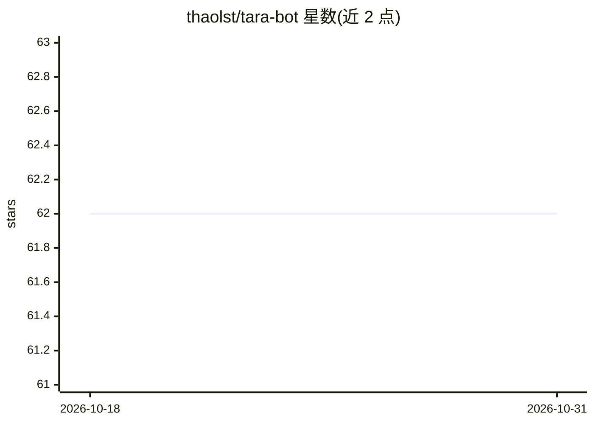

# thaolst/tara-bot

⭐ 62 · Python · MIT · 推送 2026-06-14 · [GitHub](https://github.com/thaolst/tara-bot) · 个人维护 · 中文 README

**个人 Telegram AI agent：查机票、比价、看出行吉日**

部署在 Fly.io 上的 Telegram 机器人，用自然语言对话完成机票搜索（Google Flights 实时价格、返回前 5 航班）、商品比价（Google Shopping）、每日 9 点价格监控（GitHub Actions 定时任务）等任务。LLM 后端支持 Anthropic Claude 或 OpenAI 兼容接口（含 Gemini、本地 LLM），具备会话记忆、prompt caching、多轮工具调用（最多 5 圈）与私有模式（仅白名单用户 ID 可用）。另含基于传统干支历的出行择日功能（带免责声明，仅在用户主动询问时触发）。需自备 Telegram token、Anthropic API key 与 SerpAPI key。

## 筛选速览

| 维度 | 判定 | 备注 |
|---|---|---|
| AI 角色 | `ai-native` | 本体是模型或模型工具 |
| 许可风险 | `permissive` | MIT |
| 部署形态 | `library` | 以包/库形式分发 |
| 模型依赖 | locked-api |  |
| 硬件要求 | — | 无带数字的原话,不猜 |
| 安装摩擦 | `low` | 无编译、无系统依赖或容器化 |
| 成熟度 | — | 结构信号不足 |

## 能力要点

- 自然语言对话调用机票搜索、比价等工具，最多 5 轮多轮工具循环
- 支持 Anthropic Claude 与 OpenAI 兼容后端（Gemini、本地 LLM）
- 每日 9 点自动监控 4 条航线价格并发送 Telegram 通知
- prompt caching 从第 2 轮起缓存 system prompt，降低 token 成本

## 适用场景

- 用 Telegram 对话查机票价格并获取 Google Flights 链接
- 每天自动收到关注航线的价格监控通知
- 对比商品价格、查看店铺评分与购买链接

## 场景标签

`AI 助手` · 领域:对话与助手

## 证据(README 行号)

> L21: |💬 **Chat tự nhiên**|Hỏi "tìm vé SG Đà Nẵng cuối tuần" — Claude hiểu ngữ cảnh, tự gọi đúng tool|✅|
> L74: |**AI**|Claude Sonnet 4.6 (Anthropic) hoặc OpenAI-compatible (Gemini, ...)|
> L30: |🔄 **LLM mode switch**|Hỗ trợ Anthropic Claude hoặc OpenAI-compatible (Gemini, local LLM)|✅|

## 星数曲线

2026-10-18 62 → 2026-10-31 62（+0）

---
*卡片 v1 · prompt 1.4 · 生成 2026-10-24 · 置信度 mid · 依据 README sha `0f0fdd0f033f` · [字段定义](../../DATASET.md)*
