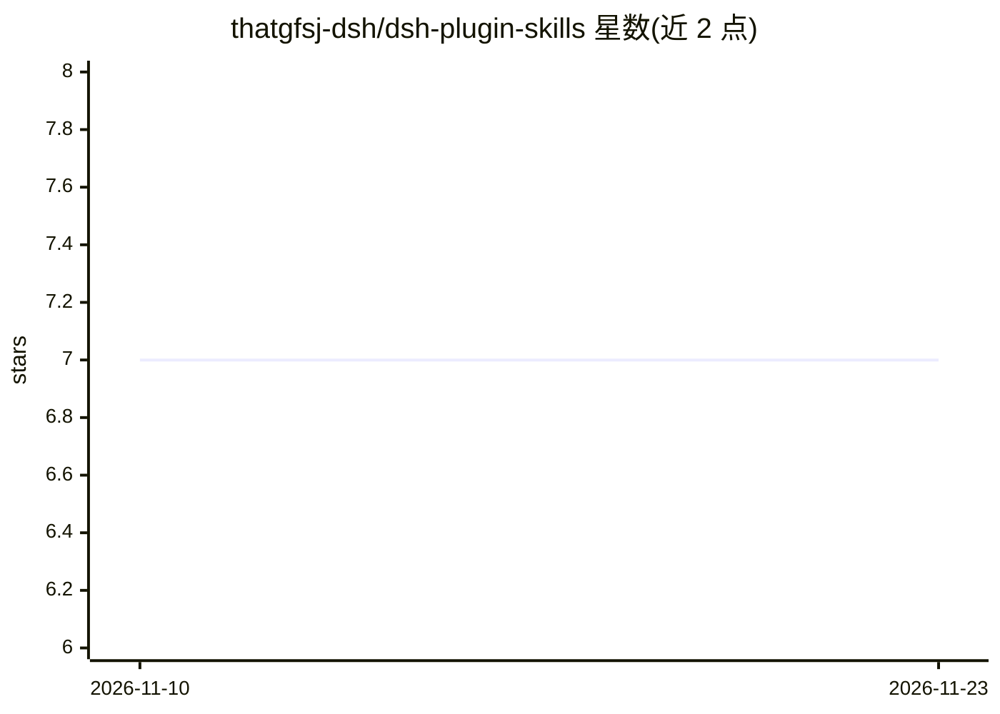

# thatgfsj-dsh/dsh-plugin-skills

⭐ 7 · JavaScript · MIT · 推送 2026-11-21 · [GitHub](https://github.com/thatgfsj-dsh/dsh-plugin-skills) · 个人维护 · 中文 README

**给 AI agent 编写 DSH 插件构建与技能的技能包**

面向 AI agent 的 DeepSeek Harness（DSH）知识技能包，按 dsh 版本分目录维护三套技能：插件构建打包与排障、技能编写与校验规则、内部结构解构（服务/事件/slot/包四张机器生成事实表）。每条结论标注来源与核实方式，区分实测与静态分析状态，并跟踪版本间破坏性变更。git clone 后经 scripts/install.sh 安装到 ~/.dsh/skills，校验脚本零依赖。

## 筛选速览

| 维度 | 判定 | 备注 |
|---|---|---|
| AI 角色 | `ai-knowledge` | 知识聚合/清单类 |
| 许可风险 | `permissive` | MIT |
| 部署形态 | `None` |  |
| 模型依赖 | — | README 未给出锁定关系 |
| 硬件要求 | — | 无带数字的原话,不猜 |
| 安装摩擦 | `low` | 无编译、无系统依赖或容器化 |
| 成熟度 | — | 结构信号不足 |

## 能力要点

- 按 dsh 版本分目录维护技能包，install.sh 自动匹配本机 dsh 版本
- 服务/事件/slot/包四张事实表由安装产物机器生成
- 带零依赖校验脚本，区分 DSH 会拒绝的 FAIL 与风格 WARN
- 记录版本破坏性变更与实测推翻的常见说法

## 适用场景

- 为 DSH 编写和打包插件时让 agent 参考版本准确的契约规则
- 排查技能写完未被加载或插件静默失败的问题
- 升级 dsh 版本后查找破坏性变更清单

## 场景标签

`提示工程` · 领域:Agent 开发

## 证据(README 行号)

> L7: 给 AI agent 用的 DeepSeek Harness（DSH）技能包：**怎么构建 DSH 插件**，以及**怎么写 DSH 技能**。
> L62: **不在每次 PR / push 时构建和跑检查。** 这个仓库交付的是数据（Markdown 技能），不是要编译的代码；评审时本地跑两条命令即可：

## 星数曲线

2026-11-10 7 → 2026-11-23 7（+0）

---
*卡片 v1 · prompt 1.4 · 生成 2026-11-21 · 置信度 high · 依据 README sha `1fd3baf8ef20` · [字段定义](../../DATASET.md)*
