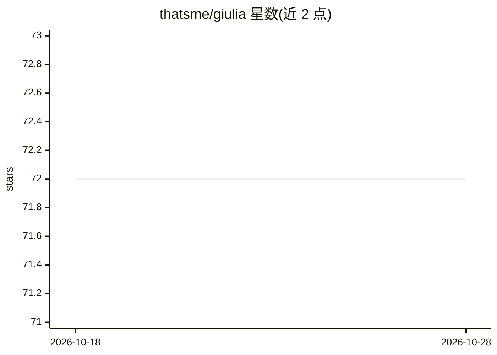

# thatsme/giulia

⭐ 72 · Elixir · NOASSERTION · 推送 2026-09-18 · [GitHub](https://github.com/thatsme/giulia) · 个人维护

**给 Elixir 开发者的本地优先代码智能守护进程，供 LLM 客户端调用**

用 Elixir/OTP 编写的长驻后台守护进程，面向单人 Elixir/Phoenix 项目开发者：对代码库做 Sourceror AST 解析、构建属性图、依赖与影响面（blast radius）分析、复杂度与死代码检测，并支持经分布式 Erlang 连接运行中 BEAM 节点做运行时内省；数据经 88 个 REST 端点与原生 MCP（75 个工具）暴露给 Claude Code 等外部 LLM 客户端，自身不调用 LLM、不改文件。三层存储（ETS/CubDB/ArcadeDB）实现重启后热恢复，以 Docker 双容器（worker+monitor）运行，需约 7GB 内存。v0.3.8 为 pre-1.0，API 可能变化；早期内置的本地 LLM 推理层已声明弃用，将在 v0.4.0 移除。

## 筛选速览

| 维度 | 判定 | 备注 |
|---|---|---|
| AI 角色 | `ai-ecosystem` | LLM/agent 周边工具 |
| 许可风险 | `none` | NOASSERTION |
| 部署形态 | `self-host` | docker 或自建部署 |
| 模型依赖 | — | README 未给出锁定关系 |
| 硬件要求 | — | 无带数字的原话,不猜 |
| 安装摩擦 | `low` | 无编译、无系统依赖或容器化 |
| 成熟度 | `idea` | |

## 能力要点

- AST 级静态分析 + 属性图：依赖、中心度、影响面、耦合热图、死代码分类
- 经分布式 Erlang 连接运行中 BEAM 节点做运行时内省并与静态数据融合
- 88 个 REST 端点 + 原生 MCP（75 工具、bearer token）暴露只读数据面
- CubDB/ArcadeDB 三层存储支持跨重启热恢复与增量重扫

## 适用场景

- 让 Claude Code 等 AI 助手跨会话保持对大型 Elixir 项目的上下文
- 重构前查询某函数的影响面与调用者数量
- 可视化浏览模块依赖拓扑与风险热图

## 场景标签

`Agent 记忆` · 领域:Agent 开发

## 证据(README 行号)

> L9: > **Giulia is the eyes, not the brain.** It analyzes your codebase and serves structured data over REST and MCP. You
> L13: Giulia is a persistent, local-first code intelligence daemon built in Elixir/OTP. It runs as a long-lived backgroun
> L185: Canonical LLM integration is now external clients (Claude Code, Claude Desktop, etc.) calling Giulia over REST or 

## 星数曲线

2026-10-18 72 → 2026-10-28 72（+0）

---
*卡片 v1 · prompt 1.4 · 生成 2026-10-24 · 置信度 high · 依据 README sha `e23621f29539` · [字段定义](../../DATASET.md)*
