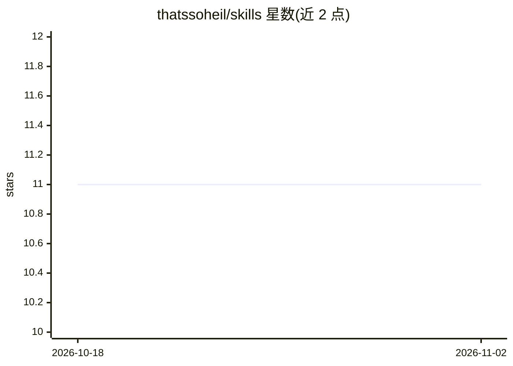

# thatssoheil/skills

⭐ 11 · MIT · 推送 2026-08-01 · [GitHub](https://github.com/thatssoheil/skills) · 个人维护 · 中文 README

**面向任意 AI agent 的即用技能合集，一行命令安装**

按 skills.sh / Agent Skills 标准组织的技能集合：每个技能是包含 SKILL.md 的独立文件夹，向 AI agent 提供专业工作流指令。技能与 agent 无关，同一技能可安装到 Hermes、Claude Code、Codex、Cursor、Goose、OpenCode、Zed 等多种 agent，通过 npx skills add 命令按需安装单个或全部技能，支持 -g 全局安装与免终端的复制粘贴 prompt 版本（另一仓库）。采用 MIT 许可，技能持续扩充。

## 筛选速览

| 维度 | 判定 | 备注 |
|---|---|---|
| AI 角色 | `ai-knowledge` | 知识聚合/清单类 |
| 许可风险 | `permissive` | MIT |
| 部署形态 | `library` | 以包/库形式分发 |
| 模型依赖 | — | README 未给出锁定关系 |
| 硬件要求 | — | 无带数字的原话,不猜 |
| 安装摩擦 | `low` | 无编译、无系统依赖或容器化 |
| 成熟度 | — | 结构信号不足 |

## 能力要点

- 遵循 skills.sh / Agent Skills 标准（每技能一个 SKILL.md）
- 同一技能可安装到多种 agent（Hermes/Claude Code/Codex/Cursor 等）
- npx 一行命令按需安装，支持全局安装与免安装预览
- 提供面向普通用户的复制粘贴 prompt 版本（另一仓库）

## 适用场景

- 给我的 AI agent 安装现成的专业工作流技能
- 不用写提示词直接让 agent 按成熟流程工作
- 在 ChatGPT/Claude/Gemini 中直接粘贴使用技能 prompt

## 场景标签

`提示工程` · 领域:Agent 开发

## 证据(README 行号)

> L5: A collection of ready-made **skills** (expert instructions) that teach any AI agent how to do professional work.
> L73: Follows the skills.sh / Agent Skills standard: one folder per skill under `skills/`, each containing a `SKILL.md`.

## 星数曲线

2026-10-18 11 → 2026-11-02 11（+0）

---
*卡片 v1 · prompt 1.4 · 生成 2026-11-01 · 置信度 high · 依据 README sha `a54f01cce92e` · [字段定义](../../DATASET.md)*
