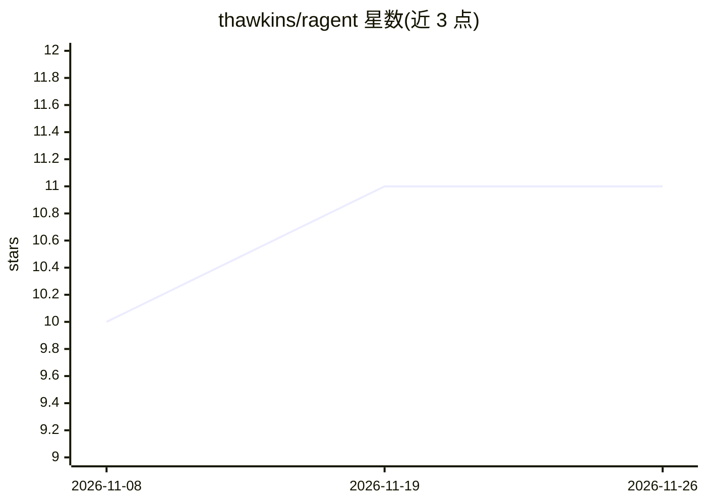

# thawkins/ragent

⭐ 11 · Rust · MIT · 推送 2026-11-14 · [GitHub](https://github.com/thawkins/ragent) · 个人维护

**终端里的 Rust AI 编码 Agent，编排多家 LLM 提供商**

用 Rust 实现的终端编码 Agent，灵感来自 RooCode、Claude Code、Copilot CLI 与 OpenCode。提供多提供商 LLM 编排（15 个注册表条目）、内置工具系统（文件、Bash、Git、GitHub/GitLab、Web、代码索引、团队协作等分类工具）、ratatui 终端 UI 与客户端/服务器架构，编译为仅链接系统 C 运行时的单一二进制。支持 local/docker/podman/remote 可插拔执行后端，Bash 工具带 7 层安全校验，可选 LLM 安全分析器对工具动作给出 allow/ask/deny 判定。作者声明其为学习性项目。

## 筛选速览

| 维度 | 判定 | 备注 |
|---|---|---|
| AI 角色 | `ai-ecosystem` | LLM/agent 周边工具 |
| 许可风险 | `permissive` | MIT |
| 部署形态 | `None` |  |
| 模型依赖 | local-ok | 支持本地模型 |
| 硬件要求 | — | 无带数字的原话,不猜 |
| 安装摩擦 | `medium` | 含编译或系统依赖之一 |
| 成熟度 | — | 结构信号不足 |

## 能力要点

- 多提供商 LLM 编排：15 个注册表条目，含本地优先默认解析到 Ollama
- 内置 100+ 工具，覆盖文件、Bash、Git、GitHub/GitLab、Web、团队协作与 MCP 外部服务器
- 可插拔执行后端：local、docker/podman 容器、remote REST+SSE
- 7 层 Bash 安全校验与可选 LLM 权限分析器

## 适用场景

- 在终端中通过对话方式让 Agent 读写代码、执行 shell 与 Git 操作
- 配置多个 LLM 提供商并在无云端配置时自动回退到本地 Ollama
- 在容器沙箱中运行 Agent 的工具会话
- 用团队工具与后台 Agent 协作完成任务生命周期管理

## 场景标签

`编码 Agent` · 领域:编码与开发

## 证据(README 行号)

> L9: ragent is a Rust coding agent inspired by RooCode, Claude Code, Copilot CLI and
> L10: OpenCode. It provides multi-provider LLM orchestration, a comprehensive built-in
> L34: - **Pluggable execution backends** — select *where* a session's tools run without

## 星数曲线

2026-11-08 10 → 2026-11-26 11（+1）

---
*卡片 v1 · prompt 1.4 · 生成 2026-11-19 · 置信度 high · 依据 README sha `f11afbdf296d` · [字段定义](../../DATASET.md)*
