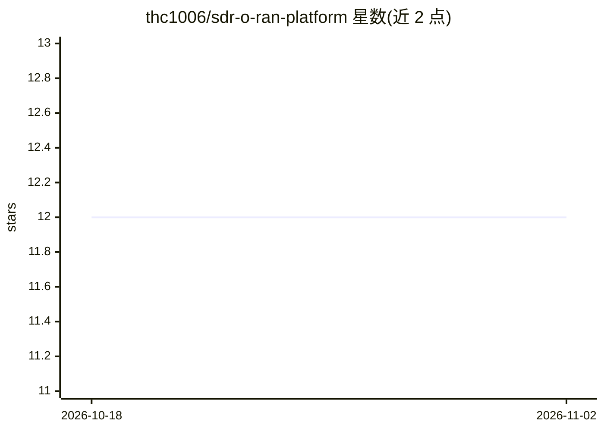

# thc1006/sdr-o-ran-platform

⭐ 12 · Python · 推送 2026-04-05 · [GitHub](https://github.com/thc1006/sdr-o-ran-platform) · 个人维护 · 中文 README

**面向科研的 SDR 卫星地面站与 O-RAN NTN 集成研发平台**

研究型开发平台，将软件定义无线电卫星地面站与云原生 O-RAN 架构集成，用于非地面网络（NTN）通信研究，遵循 MBSE 方法论与 3GPP Release 18/19、O-RAN Alliance 规范。包含 LEO NTN 仿真器（GPU 加速）、SDR API 网关、gRPC 流服务、DRL 功控训练（DQN/PPO，Stable Baselines3）、流量调度 xApp 及 NIST 后量子密码实现（ML-KEM-1024/ML-DSA-87）。整体完成度约 85%，SDR 部分当前使用仿真数据，实际部署需 USRP X310 硬件，端到端集成测试未完成，README 明确不建议直接用于生产环境。

## 筛选速览

| 维度 | 判定 | 备注 |
|---|---|---|
| AI 角色 | `ai-enhanced` | 去掉 AI 部分产品仍成立 |
| 许可风险 | `none` | — |
| 部署形态 | `self-host` | docker 或自建部署 |
| 模型依赖 | — | README 未给出锁定关系 |
| 硬件要求 | — | 无带数字的原话,不猜 |
| 安装摩擦 | `low` | 无编译、无系统依赖或容器化 |
| 成熟度 | `idea` | |

## 能力要点

- 3GPP TR 38.811/38.821 兼容的 NTN 物理层仿真（斜距/FSPL/多普勒/莱斯衰落）
- DQN/PPO 功控训练与评估，对比规则基线给出统计显著性结果
- ML-KEM-1024 与 ML-DSA-87 后量子密码实现，与 X25519 混合
- LEO-SDR 集成实测记录：38,000+ 帧发送、14,694+ 帧接收、零丢包

## 适用场景

- 5G/6G NTN 通信架构研究与学习参考
- O-RAN xApp/RIC 组件的原型验证
- 卫星链路上 RL 功控算法的实验复现
- 作为自定义 SDR-O-RAN 实现的开发起点

## 场景标签

`科研工具` · 领域:学习与行业

## 证据(README 行号)

> L14: This project is a research and development platform integrating Software-Defined Radio (SDR) satellite ground stati
> L168: - **Training**: Stable Baselines3 (PPO, SAC algorithms)
> L62: - DRL training pipeline (PPO/SAC algorithms, 1000 timesteps)

## 星数曲线

2026-10-18 12 → 2026-11-02 12（+0）

---
*卡片 v1 · prompt 1.4 · 生成 2026-10-31 · 置信度 high · 依据 README sha `9810c9102ea7` · [字段定义](../../DATASET.md)*
