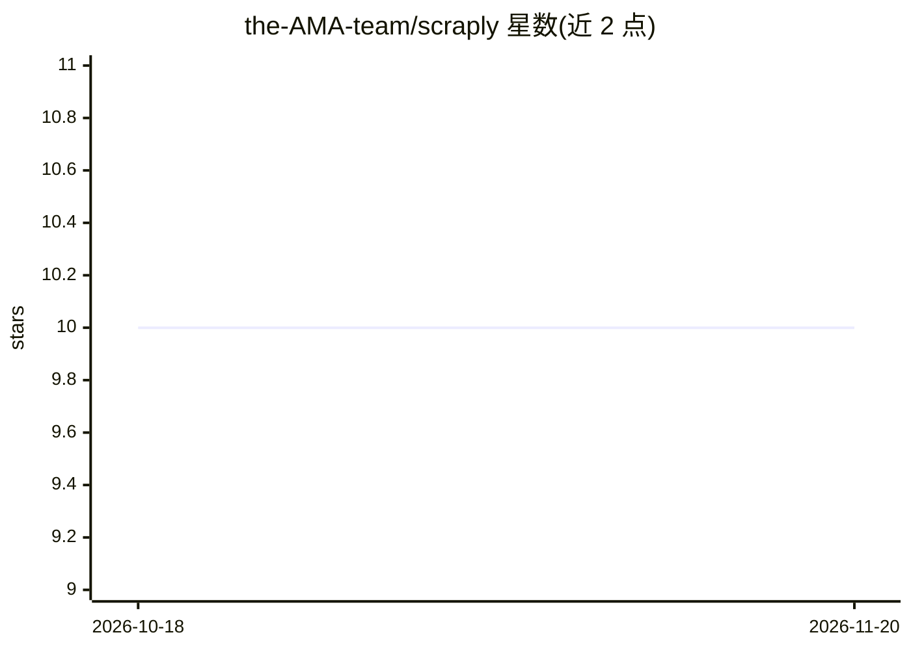

# the-AMA-team/scraply

⭐ 10 · TypeScript · 推送 2026-10-05 · [GitHub](https://github.com/the-AMA-team/scraply) · [官网](https://scraply-five.vercel.app/) · 组织维护

**神经网络的拖拽式 no-code 深度学习训练平台**

面向非代码用户的深度学习平台：拖拽神经网络层即可生成 PyTorch 配置，实时设置训练参数并查看训练曲线，支持停止/恢复训练，输出可视化针对图像数据集有特殊展示；内置 PEEK 方法对 CNN 卷积层生成基于熵的热力图以可视化决策过程；训练后可导出 Python notebook 复现全部操作。部署方式为本地克隆仓库、pip 安装依赖并用 uvicorn 启动服务端。

## 筛选速览

| 维度 | 判定 | 备注 |
|---|---|---|
| AI 角色 | `ai-native` | 本体是模型或模型工具 |
| 许可风险 | `none` | — |
| 部署形态 | `library` | 以包/库形式分发 |
| 模型依赖 | — | README 未给出锁定关系 |
| 硬件要求 | — | 无带数字的原话,不猜 |
| 安装摩擦 | `low` | 无编译、无系统依赖或容器化 |
| 成熟度 | — | 结构信号不足 |

## 能力要点

- 拖拽网络层并实时查看模型 PyTorch 配置
- 训练后下载 Python notebook 查看全部代码
- PEEK 熵热力图可视化 CNN 决策过程
- 实时训练曲线与停止/恢复训练

## 适用场景

- 教学场景中不写代码搭建和训练神经网络
- 调试 CNN 时查看卷积层热力图理解模型关注区域
- 导出 notebook 继续在代码层面扩展实验

## 场景标签

`模型训练` `MLOps` · 领域:训练与推理

## 证据(README 行号)

> L3: ### A no-code, deep learning platform -- The "Scratch" for Neural Networks
> L8: ### 1) Drag and drop neural network layers. View your model's PyTorch configuration

## 星数曲线

2026-10-18 10 → 2026-11-20 10（+0）

---
*卡片 v1 · prompt 1.4 · 生成 2026-11-19 · 置信度 high · 依据 README sha `c82064dfb6a8` · [字段定义](../../DATASET.md)*
