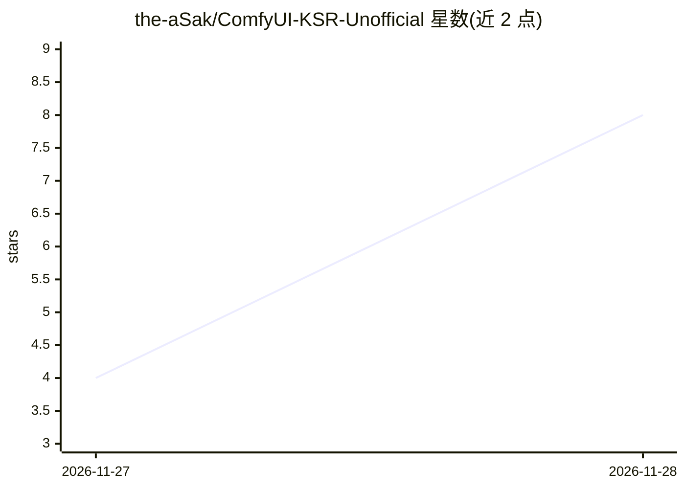

# the-aSak/ComfyUI-KSR-Unofficial

⭐ 8 · Python · MIT · 推送 2026-11-27 · [GitHub](https://github.com/the-aSak/ComfyUI-KSR-Unofficial) · 个人维护

**在 ComfyUI 中原生运行 Kandinsky 图像超分模型的节点包**

为 ComfyUI 提供非官方社区节点，接入 Kandinsky Lab 的 Kandinsky ImageSR 2.0——一个 5B 参数、单步扩散、支持 x2/x4 放大且不含文本编码器的超分辨率模型。Transformer 以 ComfyUI 原生 ops 与内存管理实现，支持部分 offload、fp8 权重与 ComfyUI 的注意力后端，复用核心 Load VAE 节点加载 FLUX.1 VAE，无需额外 Python 包。安装走 git clone 或 ComfyUI-Manager；模型权重约 10.3 GB，也可用脚本从原始 release 自行构建。支持分块（tiling）处理与 creativity 参数控制。

## 筛选速览

| 维度 | 判定 | 备注 |
|---|---|---|
| AI 角色 | `ai-native` | 本体是模型或模型工具 |
| 许可风险 | `permissive` | MIT |
| 部署形态 | `None` |  |
| 模型依赖 | — | README 未给出锁定关系 |
| 硬件要求 | — | 无带数字的原话,不猜 |
| 安装摩擦 | `medium` | 含编译或系统依赖之一 |
| 成熟度 | — | 结构信号不足 |

## 能力要点

- 原生实现于 ComfyUI ops 与内存管理，支持部分 offload 与 fp8 权重
- 分块三阶段流程（VAE encode → transformer → decode 混合），模型只加载一次
- 确定性输出：无 seed、无噪声；提供校准 presets 与 creativity 参数
- 提供 bf16/fp8 的性能与精度（PSNR）对比数据

## 适用场景

- 在 ComfyUI 工作流中把 512px 低分辨率图像放大 2 倍或 4 倍
- 对比生成式超分与 bicubic 的放大效果
- 低显存环境下用 fp8 权重运行大模型推理

## 场景标签

`图像视频处理` · 领域:感知与多模态

## 证据(README 行号)

> L5: ComfyUI nodes for Kandinsky ImageSR 2.0 by Kandinsky Lab,
> L10: The transformer is implemented natively on ComfyUI's ops and memory management. It supports partial offloading,
> L42: `Load Image` → **Kandinsky ImageSR Upscale** ← **Kandinsky ImageSR Model Loader** + `Load VAE` → `Save Image`

## 星数曲线

2026-11-27 4 → 2026-11-28 8（+4）

---
*卡片 v1 · prompt 1.4 · 生成 2026-11-27 · 置信度 high · 依据 README sha `e745d73d3d66` · [字段定义](../../DATASET.md)*
