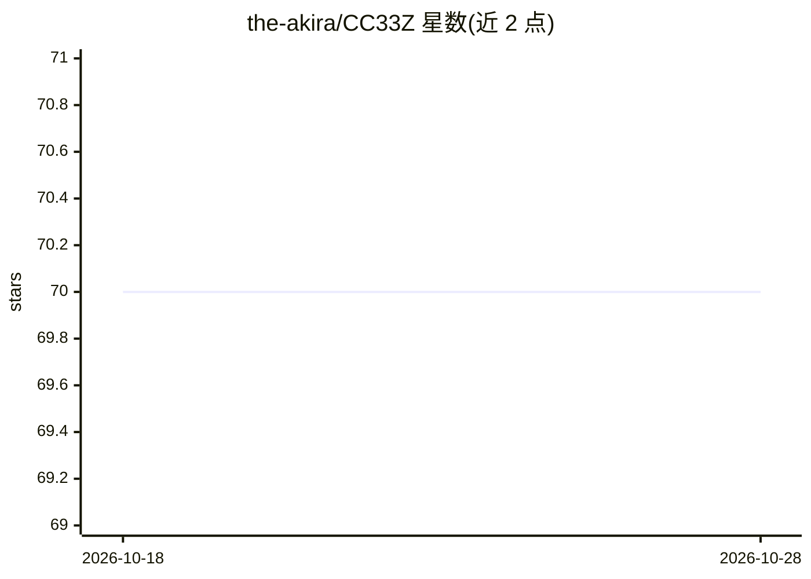

# the-akira/CC33Z

⭐ 70 · Jupyter Notebook · 推送 2026-10-26 · [GitHub](https://github.com/the-akira/CC33Z) · [官网](https://cc33z.pythonanywhere.com) · 个人维护

**计算机科学自学课程目录：覆盖算法到机器学习等多学科**

由 Gabriel Felippe 构想并讲授的计算机科学课程集合，按学科组织为约 20 门课程，涵盖编程基础、算法与数据结构、Web 开发、数据分析、计算机网络、Linux、Django、机器学习、计算机视觉、数据库、信息安全、神经网络、2D 游戏开发、物理基础与电子学基础等。以课程目录形式呈现，供学习者按学科路径自学计算机科学。README 未给出安装或运行方式。

## 筛选速览

| 维度 | 判定 | 备注 |
|---|---|---|
| AI 角色 | `ai-knowledge` | 知识聚合/清单类 |
| 许可风险 | `none` | — |
| 部署形态 | `None` |  |
| 模型依赖 | — | README 未给出锁定关系 |
| 硬件要求 | — | 无带数字的原话,不猜 |
| 安装摩擦 | `low` | 无编译、无系统依赖或容器化 |
| 成熟度 | — | 结构信号不足 |

## 能力要点

- 约 20 门按学科组织的计算机科学课程
- 覆盖从编程基础到机器学习、计算机视觉、神经网络的进阶内容
- 包含 Linux、信息安全、Web Scraping、电子学等实用主题

## 适用场景

- 按学科路径系统自学计算机科学
- 查找特定主题（如机器学习、计算机网络）的学习材料

## 场景标签

`教程课程` · 领域:学习与行业

## 证据(README 行号)

> L1: # Curso de Ciência da Computação
> L7: ## Disciplinas

## 星数曲线

2026-10-18 70 → 2026-10-28 70（+0）

---
*卡片 v1 · prompt 1.4 · 生成 2026-10-24 · 置信度 high · 依据 README sha `19046e340360` · [字段定义](../../DATASET.md)*
