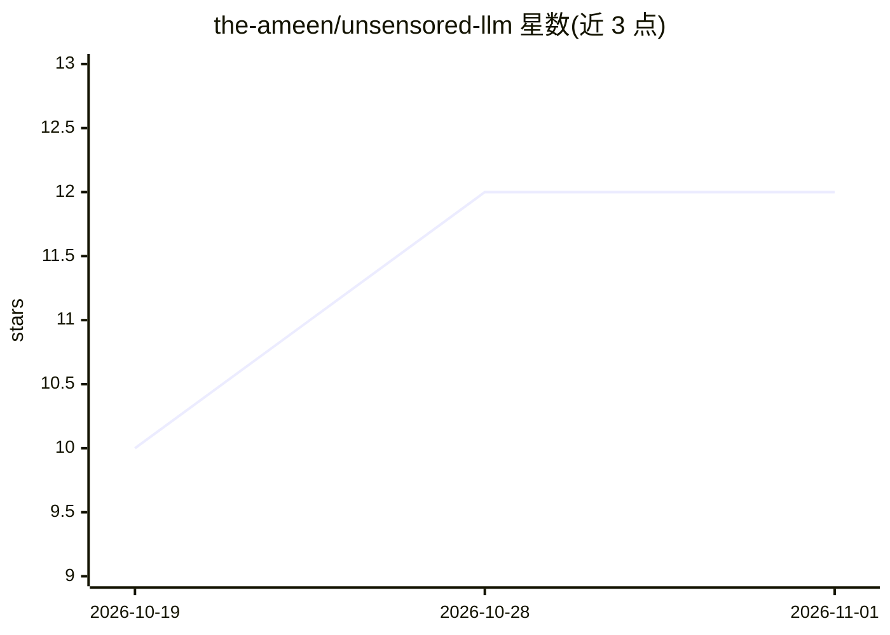

# the-ameen/unsensored-llm

⭐ 12 · HTML · GPL-3.0 · 推送 2026-10-20 · [GitHub](https://github.com/the-ameen/unsensored-llm) · 个人维护

**便携式本地 LLM 聊天环境：免安装、离线运行于硬盘或 U 盘**

由 Mohd Ameen 打包的气隙化本地 AI 环境：自带隔离的引擎二进制与便携运行时配置，从本地硬盘或 USB/SSD 运行，无需系统权限、注册表修改或包管理器。通过 Shared 共享卷机制，模型下载一次即可在 Windows/macOS/Linux/Android 间复用；预置 6 个精选 GGUF 模型（约 1.6-7GB），也支持手动放置任意 .gguf。启动后在本机 3333 端口提供 Web 聊天界面，支持局域网手机访问，按主机动态利用 CPU AVX/AVX2、Apple Metal 或 NVIDIA CUDA。限制：模型超出 RAM/VRAM 时推理变慢。

## 筛选速览

| 维度 | 判定 | 备注 |
|---|---|---|
| AI 角色 | `ai-native` | 本体是模型或模型工具 |
| 许可风险 | `viral` | GPL-3.0 |
| 部署形态 | `None` |  |
| 模型依赖 | local-ok | 支持本地模型 |
| 硬件要求 | — | 无带数字的原话,不猜 |
| 安装摩擦 | `medium` | 含编译或系统依赖之一 |
| 成熟度 | — | 结构信号不足 |

## 能力要点

- 零依赖便携运行，支持 USB/SSD 携带跨 Windows/macOS/Linux/Android
- Shared 共享卷机制：模型下载一次跨系统复用不重复占用存储
- 预置 6 个精选 GGUF 模型并支持自定义 .gguf 放入 Shared/models/
- 本机 Web 聊天界面（localhost:3333）与局域网手机/平板访问

## 适用场景

- 在无网络或需离线的环境运行本地 LLM 聊天
- 把模型装在 U 盘/移动硬盘上跨多台电脑携带使用
- 在手机或平板上通过局域网访问主机上运行的本地模型

## 场景标签

`聊天机器人` · 领域:对话与助手

## 证据(README 行号)

> L3: **Uncensored-LLM** is a fully air-gapped, zero-dependency, plug-and-play Local AI environment designed to run seamle
> L12: * **Local Web Interface:** Serves a blazing-fast, responsive dark-mode chat UI with real-time host CPU/RAM hardware

## 星数曲线

2026-10-19 10 → 2026-11-01 12（+2）

---
*卡片 v1 · prompt 1.4 · 生成 2026-10-31 · 置信度 high · 依据 README sha `d569a8541b7c` · [字段定义](../../DATASET.md)*
