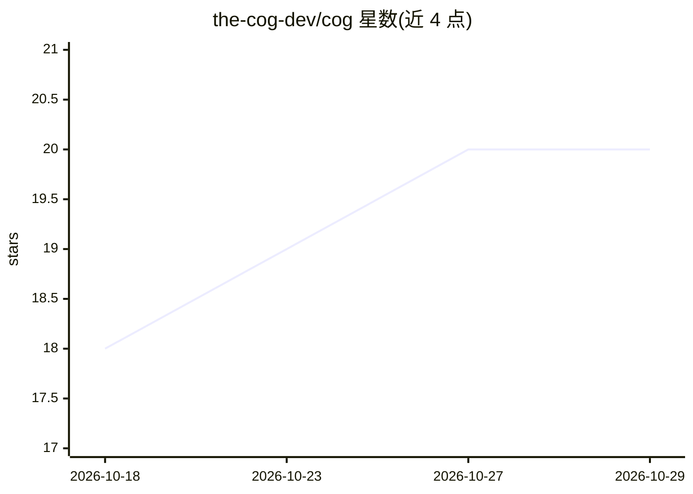

# the-cog-dev/cog

⭐ 20 · TypeScript · 推送 2026-07-29 · [GitHub](https://github.com/the-cog-dev/cog) · [官网](https://TheCog.dev) · 组织维护

**面向开发者的多 AI 编程 agent 编排 IDE**

The Cog 是基于 Electron/TypeScript 的桌面 IDE，用于编排多个 AI 编程 CLI agent：在无限画布上以浮动终端窗口运行 Claude Code、Codex、Kimi、Gemini、Copilot、Grok 等 agent，通过 31 个 MCP 工具实现 agent 间消息、任务板、共享知识、调度与文件读写。功能含定时提示、agent 自调度（默认需人工批准）、可被 agent 读取的可视化 Sketchpad、实验性 Remote View 手机远程管理、39 个预设模板与社区团队共享。从源码安装，需 Node.js 20+ 与至少一个 AI CLI。

## 筛选速览

| 维度 | 判定 | 备注 |
|---|---|---|
| AI 角色 | `ai-ecosystem` | LLM/agent 周边工具 |
| 许可风险 | `none` | — |
| 部署形态 | `library` | 以包/库形式分发 |
| 模型依赖 | locked-api |  |
| 硬件要求 | — | 无带数字的原话,不猜 |
| 安装摩擦 | `low` | 无编译、无系统依赖或容器化 |
| 成熟度 | `idea` | |

## 能力要点

- 多模型多 CLI agent 团队编排，31 个 MCP 工具支撑消息/任务/调度/文件协作
- 定时提示与 agent 自调度（默认 gated 需批准，可按项目切 autonomous）
- Sketchpad 可视化画布渲染为 PNG 供 agent 读取
- Remote View（实验性）通过 Cloudflare 隧道从手机管理 agent

## 适用场景

- 在一个工作区里同时运行多个 AI 编程 agent 并分配角色协作
- 长时间离席时用定时提示保持 agent 团队持续工作
- 通过手机远程查看 agent 状态、发消息和管理调度

## 场景标签

`编码 Agent` `多智能体` · 领域:Agent 开发

## 证据(README 行号)

> L3: thecog.dev · The AI-native agent orchestration IDE. Spawn teams of AI coding agents across multiple models and provi
> L14: - **Multi-model teams** — Claude, Codex, Kimi, Gemini, Copilot, Grok, OpenClaude (200+ models via OpenAI-compatible

## 星数曲线

2026-10-18 18 → 2026-10-29 20（+2）

---
*卡片 v1 · prompt 1.4 · 生成 2026-10-28 · 置信度 high · 依据 README sha `81aa3e832412` · [字段定义](../../DATASET.md)*
