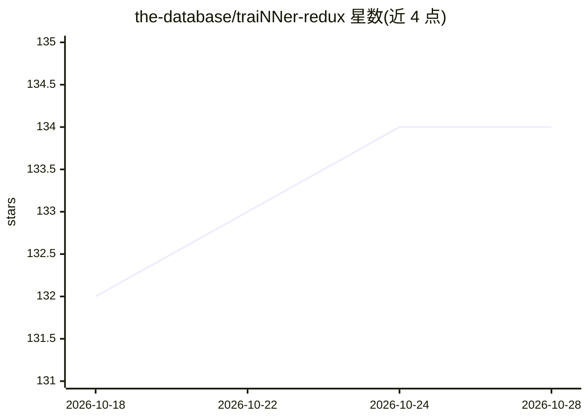

# the-database/traiNNer-redux

⭐ 134 · Python · Apache-2.0 · 推送 2026-10-09 · [GitHub](https://github.com/the-database/traiNNer-redux) · [官网](https://trainner-redux.readthedocs.io) · 个人维护

**图像超分与修复的 PyTorch 模型训练框架**

基于 PyTorch 的深度学习训练框架，用于训练图像超分辨率与修复模型，可将模型应用于图像和视频的放大与修复。推荐使用 NVIDIA 显卡，AMD 显卡在 Linux 上可经 ROCm 运行。README 提供周边工具链资源：OpenModelDB 作为预训练模型仓库、chaiNNer 可运行本框架训练的模型并辅助数据集准备、多个数据集退化与对齐工具。使用说明指向外部 getting started 页面。

## 筛选速览

| 维度 | 判定 | 备注 |
|---|---|---|
| AI 角色 | `ai-ecosystem` | LLM/agent 周边工具 |
| 许可风险 | `permissive` | Apache-2.0 |
| 部署形态 | `None` |  |
| 模型依赖 | — | README 未给出锁定关系 |
| 硬件要求 | — | 无带数字的原话,不猜 |
| 安装摩擦 | `low` | 无编译、无系统依赖或容器化 |
| 成熟度 | — | 结构信号不足 |

## 能力要点

- 训练 PyTorch 超分/修复模型，支持图像与视频
- NVIDIA 推荐，AMD 在 Linux 上经 ROCm 可用
- 训练出的模型可提交 OpenModelDB 并在 chaiNNer 中运行

## 适用场景

- 训练自己的图像/视频超分辨率模型
- 借助数据集退化与对齐工具构建训练数据
- 为 chaiNNer 等工具产出可用的 upscale 模型

## 场景标签

`图像视频处理` `模型训练` · 领域:感知与多模态

## 证据(README 行号)

> L5: traiNNer-redux is a deep learning training framework for image super resolution and restoration which allows you to 
> L14: - chaiNNer: General purpose tool for AI upscaling and image processing, models trained with this repo can be run on

## 星数曲线

2026-10-18 132 → 2026-10-28 134（+2）

---
*卡片 v1 · prompt 1.4 · 生成 2026-10-22 · 置信度 high · 依据 README sha `bf5703cb987d` · [字段定义](../../DATASET.md)*
