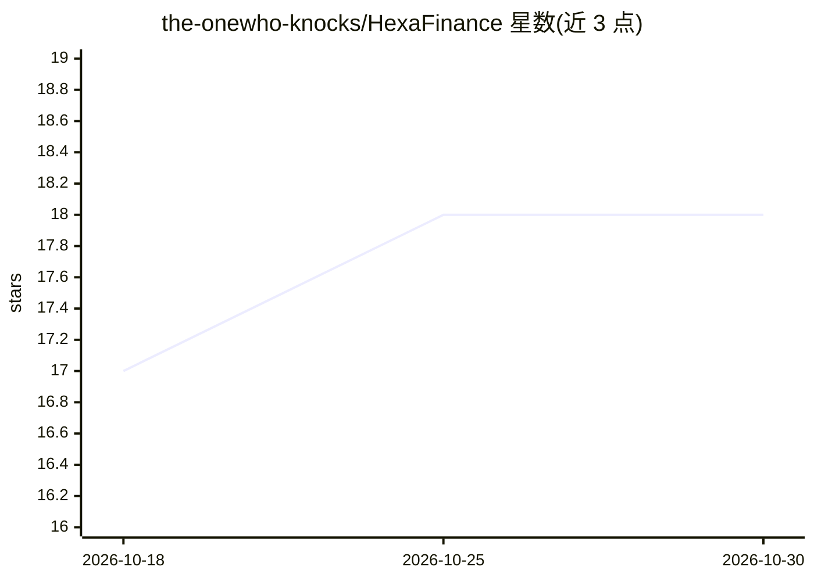

# the-onewho-knocks/HexaFinance

⭐ 18 · TypeScript · NOASSERTION · 推送 2026-07-03 · [GitHub](https://github.com/the-onewho-knocks/HexaFinance) · 个人维护

**Go 金融模拟平台，附 LangGraph 多代理股票研究服务**

Clean/六边形架构的 Go 后端，模拟投资组合管理、买卖交易、支出记录、实时行情（SSE 推流）、技术指标与净资产追踪，使用 PostgreSQL/Redis、十进制精确货币运算与 JWT/Google OAuth 认证。另含独立 Python (FastAPI + LangGraph) 研究 服务：7 节点流水线（新闻/财报/行情/SEC/RAG/记忆/聚合）生成股票研究报告，LLM 网关支持 Gemini/Groq，未配置 API key 时降级为确定性规则逻辑。面向开发者作为架构示例项目。

## 筛选速览

| 维度 | 判定 | 备注 |
|---|---|---|
| AI 角色 | `ai-enhanced` | 去掉 AI 部分产品仍成立 |
| 许可风险 | `none` | NOASSERTION |
| 部署形态 | `library` | 以包/库形式分发 |
| 模型依赖 | locked-api |  |
| 硬件要求 | — | 无带数字的原话,不猜 |
| 安装摩擦 | `low` | 无编译、无系统依赖或容器化 |
| 成熟度 | — | 结构信号不足 |

## 能力要点

- 7 节点 LangGraph 多代理研究流水线（新闻→财报→行情→SEC→RAG→记忆→聚合）
- 无 LLM key 时确定性规则降级，研究引擎不硬失败
- Go 后端：goroutine 并发行情抓取、SSE 实时价格推流、十进制精确货币运算
- SEC 文件 RAG：分段切块、Qdrant 向量检索与相关性重排

## 适用场景

- 模拟买卖股票并追踪组合、支出与净资产历史
- 获取基于 SEC 文件、财报与新闻的 AI 股票研究报告
- 学习 Go Clean/Hexagonal 架构与多服务部署模式

## 场景标签

`金融量化` `多智能体` `RAG` · 领域:Agent 开发

## 证据(README 行号)

> L3: A production-grade financial simulation platform: a **Go** backend built on Clean/Hexagonal Architecture, paired wit
> L4: The platform simulates real-world portfolio management, buy/sell transactions, expense tracking, live market data in
> L111: ### AI Stock Research Engine

## 星数曲线

2026-10-18 17 → 2026-10-30 18（+1）

---
*卡片 v1 · prompt 1.4 · 生成 2026-10-29 · 置信度 high · 依据 README sha `43b469774b52` · [字段定义](../../DATASET.md)*
