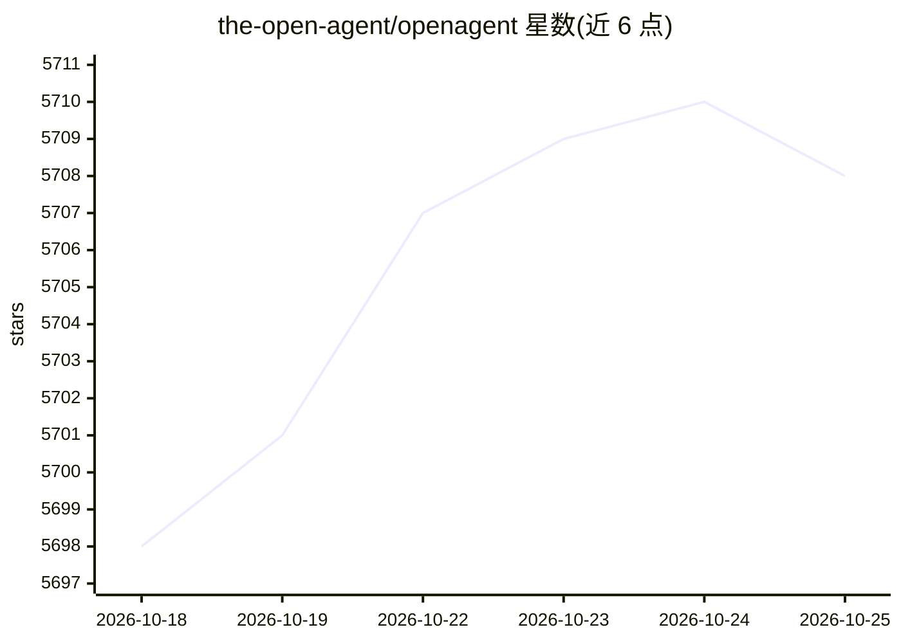

# the-open-agent/openagent

⭐ 5,708 · Go · Apache-2.0 · 推送 2026-10-24 · [GitHub](https://github.com/the-open-agent/openagent) · [官网](https://openagentai.org) · 组织维护 · 中文 README

**自托管个人 AI 助手：LLM+RAG+agent 循环，支持浏览器/代码代理**

以单一二进制分发的开源自托管个人 AI 助手平台，后端 Go、前端 Node.js。可接入 30+ 模型供应商并按会话切换，从 PDF/Word/Excel 等文档构建 RAG 知识库（可插拔嵌入模型），agent 循环支持浏览器操作、网页搜索抓取、Shell 执行、Office 自动化与 MCP 工具接入。另提供 BPMN 风格可视化工作流编辑器、定时任务、SSO（OIDC/OAuth2/LDAP/SAML）、多租户、REST API 与审计日志、用量统计面板。预编译二进制覆盖 Linux/macOS/Windows，亦提供 Docker 与源码构建，Apache 2.0 许可。

## 筛选速览

| 维度 | 判定 | 备注 |
|---|---|---|
| AI 角色 | `ai-native` | 本体是模型或模型工具 |
| 许可风险 | `permissive` | Apache-2.0 |
| 部署形态 | `self-host` | docker 或自建部署 |
| 模型依赖 | local-ok | 支持本地模型 |
| 硬件要求 | — | 无带数字的原话,不猜 |
| 安装摩擦 | `low` | 无编译、无系统依赖或容器化 |
| 成熟度 | — | 结构信号不足 |

## 能力要点

- 接入 30+ 模型供应商，按会话切换无需改代码
- agent 循环支持浏览器操作、Shell 执行、Office 自动化与 MCP 工具
- RAG 知识库：文档摄取、语义检索、可插拔嵌入、隔离存储
- 单二进制分发，内置 SSO、多租户、REST API 与审计日志

## 适用场景

- 部署一个自托管的个人 AI 助手，用自己的文档建知识库问答
- 让 agent 代我浏览网页、执行命令和处理 Office 文件
- 通过可视化编辑器编排多步自动化工作流并定时触发

## 场景标签

`AI 助手` `聊天机器人` `文档问答` `工作流自动化` · 领域:效率与自动化

## 证据(README 行号)

> L22: OpenAgent is an open-source personal AI assistant that brings together powerful LLMs, your own knowledge base, and 
> L79: `OpenAI` · `Azure OpenAI` · `Anthropic Claude` · `Google Gemini` · `DeepSeek` · `Mistral` · `Grok` · `Qwen` · `Doub

## 星数曲线

2026-10-18 5,698 → 2026-10-25 5,708（+10）

---
*卡片 v1 · prompt 1.4 · 生成 2026-10-20 · 置信度 high · 依据 README sha `fba868024c8e` · [字段定义](../../DATASET.md)*
