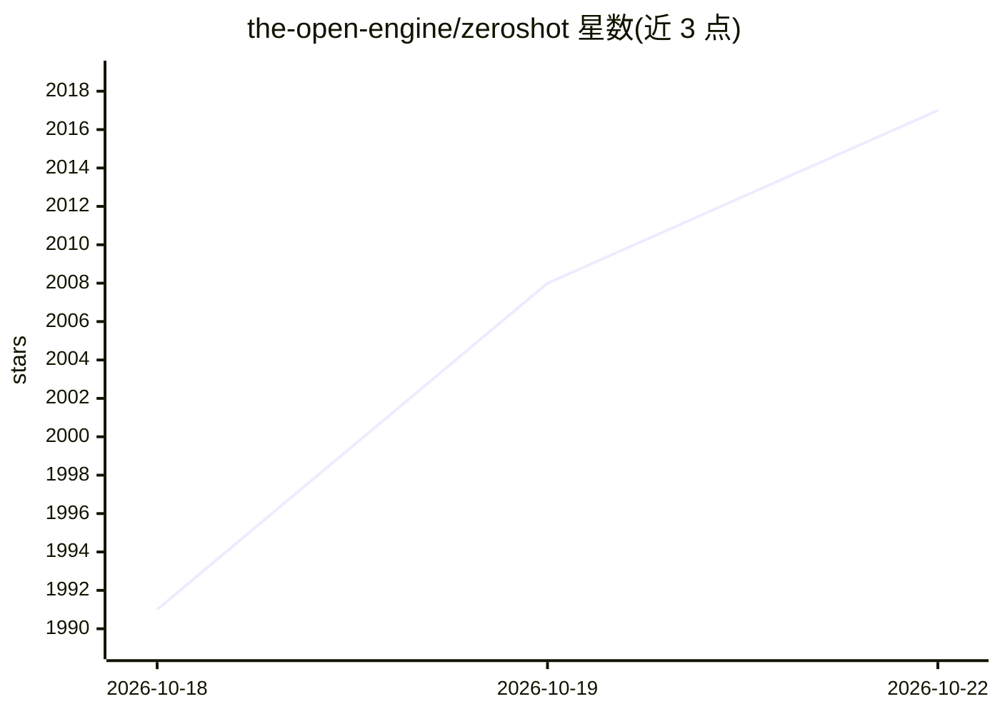

# the-open-engine/zeroshot

⭐ 2,026 · Rust · MIT · 推送 2026-10-22 · [GitHub](https://github.com/the-open-engine/zeroshot) · [官网](https://zeroshot.sh) · 组织维护

**开源编码 agent 编排引擎：自定义工作流、评审与修复循环**

面向使用编码 agent 的开发者：将任务转化为经过评审的拉取请求。用户定义工作流图（worker、验收评审、代码评审、bugfinder 等节点），每个 agent 可用不同的模型与 harness（Codex、Claude Code、GitHub Copilot、Pi）。引擎强制执行图中的评审门禁与重试上限，被拒绝的工作带回反馈交回 worker 修复。内置 software-change 与 auto-research 图，事件记录于 SQLite 账本。CLI 以 npm 全局安装（需 Node.js 18+，安装各平台原生二进制），支持本地运行、Docker 自托管目标镜像与云模式。交付模式覆盖本地保留、push、PR、ship（含 CI 与合并）。

## 筛选速览

| 维度 | 判定 | 备注 |
|---|---|---|
| AI 角色 | `ai-ecosystem` | LLM/agent 周边工具 |
| 许可风险 | `permissive` | MIT |
| 部署形态 | `self-host` | docker 或自建部署 |
| 模型依赖 | — | README 未给出锁定关系 |
| 硬件要求 | — | 无带数字的原话,不猜 |
| 安装摩擦 | `low` | 无编译、无系统依赖或容器化 |
| 成熟度 | — | 结构信号不足 |

## 能力要点

- 可自定义工作流图：并行评审节点、修复回环、重试与退出条件
- 每个 agent 可绑定不同模型与 harness（Codex/Claude Code/Copilot/Pi）
- 内置 software-change 与 auto-research（多迭代独立评审实验）模板
- 提供本地 CLI、浏览器 UI、Docker 自托管目标镜像与云运行

## 适用场景

- 让编码 agent 产出的代码经过独立评审与修复循环再交付
- 为安全敏感变更配置定向安全评审与 blast-radius 路由
- 把任务自动推进到可合并的 PR 并通过 CI
- 在自有基础设施上自托管 agent 执行与状态存储

## 场景标签

 · 领域:软件开发/AI agent 工具链

## 证据(README 行号)

> L27: Turn a task into a reviewed pull request through a workflow you control. Choose the agents and
> L37: The engine enforces the graph’s review gates and retry limits. Think of it as CI for coding agents,

## 星数曲线

2026-10-18 1,991 → 2026-10-22 2,017（+26）

---
*卡片 v1 · prompt 1.4 · 生成 2026-10-21 · 置信度 high · 依据 README sha `abeaa92369f9` · [字段定义](../../DATASET.md)*
