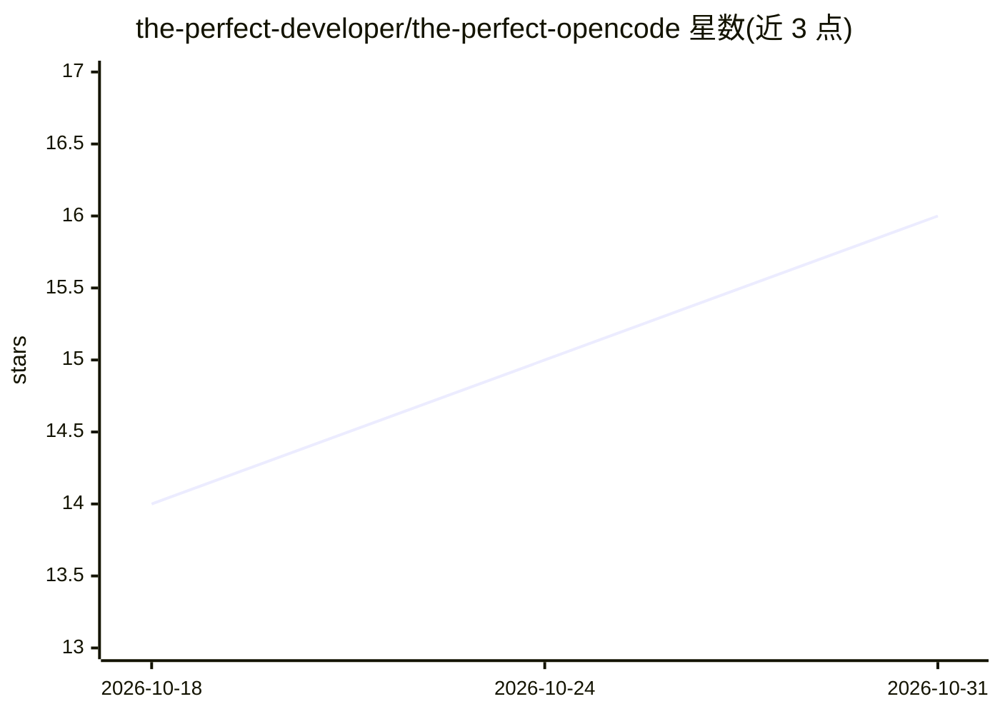

# the-perfect-developer/the-perfect-opencode

⭐ 16 · Shell · MIT · 推送 2026-04-28 · [GitHub](https://github.com/the-perfect-developer/the-perfect-opencode) · [官网](https://opencode.ai) · 个人维护

**OpenCode 的 agent/技能/命令策展集与安装器**

为 OpenCode 编辑器维护的策展工具集：包含专用 AI agents、50+ 领域技能与工作流斜杠命令（/ideate 探索、/plan 规划、/implement 实现、/evaluate 评审），并提供 curl 一行安装脚本，支持按 agent/skill/command 粒度选择性安装、更新与清单管理。安装器要求 PATH 中存在 curl、tar、jq，缺失即报错退出。另含 /create-agent、/create-skill 等扩展生成命令。面向使用 OpenCode 做 AI 辅助开发的开发者。

## 筛选速览

| 维度 | 判定 | 备注 |
|---|---|---|
| AI 角色 | `ai-knowledge` | 知识聚合/清单类 |
| 许可风险 | `permissive` | MIT |
| 部署形态 | `None` |  |
| 模型依赖 | — | README 未给出锁定关系 |
| 硬件要求 | — | 无带数字的原话,不猜 |
| 安装摩擦 | `low` | 无编译、无系统依赖或容器化 |
| 成熟度 | — | 结构信号不足 |

## 能力要点

- curl 一行安装脚本，支持 --all 或按名称选择性安装
- /ideate→/plan→/implement→/evaluate 规范开发工作流
- Ideation Expert 编排 code-analyst/solution-architect/security-expert 等专家 agents
- 安装器自动移除弃用工具并写入安装清单

## 适用场景

- 为 OpenCode 一次性配齐 AI 开发 agents 与技能
- 通过 /ideate 在动手前梳理与压测设计思路
- 按项目技术栈按需安装特定技能与命令

## 场景标签

`提示工程` `精选清单` · 领域:Agent 开发

## 证据(README 行号)

> L14: A curated collection of agents, skills, and commands for OpenCode — with a streamlined process to install, update, 
> L59: **`/install-perfect-tools`** — Guides you through discovering and installing agents, skills, and commands tailored 

## 星数曲线

2026-10-18 14 → 2026-10-31 16（+2）

---
*卡片 v1 · prompt 1.4 · 生成 2026-10-30 · 置信度 high · 依据 README sha `27dce495442a` · [字段定义](../../DATASET.md)*
