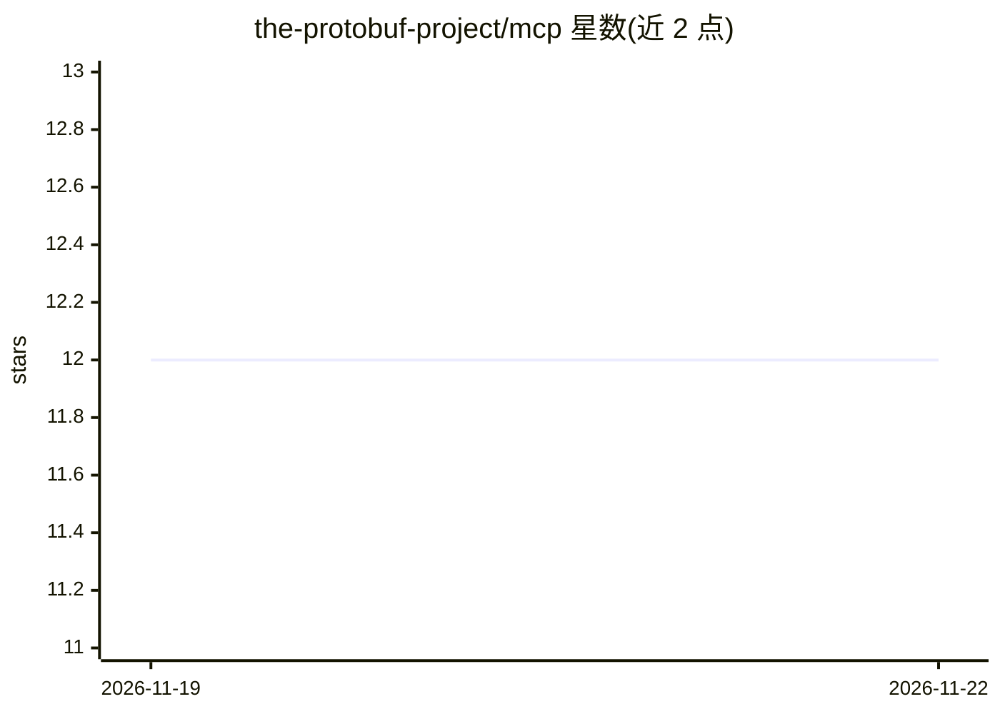

# the-protobuf-project/mcp

⭐ 12 · Go · Apache-2.0 · 推送 2026-11-19 · [GitHub](https://github.com/the-protobuf-project/mcp) · 组织维护

**protoc 插件：从 .proto 生成 Go/Rust/C++ 的 MCP 服务器**

spec-first 的 protoc-gen-mcp 插件，读取带 MCP 注解的 .proto 文件，为每个 service 生成符合 Model Context Protocol 规范（协议版本 2026-07-28）的服务器代码，支持 Go、Rust、C++ 三种语言。每个 unary RPC 自动映射为带 JSON Schema 的 MCP tool，另支持 prompt 模板、resource 自动检测、elicitation 确认流与基于 gRPC server streaming 的进度通知。生成代码基于官方 MCP SDK（go-sdk、rmcp），可进程内委托或转发到远程 gRPC 服务器，传输层支持 stdio、SSE 与 streamable-http。

## 筛选速览

| 维度 | 判定 | 备注 |
|---|---|---|
| AI 角色 | `ai-ecosystem` | LLM/agent 周边工具 |
| 许可风险 | `permissive` | Apache-2.0 |
| 部署形态 | `library` | 以包/库形式分发 |
| 模型依赖 | — | README 未给出锁定关系 |
| 硬件要求 | — | 无带数字的原话,不猜 |
| 安装摩擦 | `low` | 无编译、无系统依赖或容器化 |
| 成熟度 | — | 结构信号不足 |

## 能力要点

- 从单一 .proto 文件生成 Go/Rust/C++ 三语言的 MCP 服务器代码
- 每个 unary RPC 自动生成带 JSON Schema 的 MCP tool
- 支持 stdio/SSE/streamable-http 传输与 gRPC 转发
- 支持 elicitation 确认、prompt 模板、resource 与 progress 通知

## 适用场景

- 把已有的 protobuf/gRPC API 暴露给 MCP 客户端和 LLM agent
- 为多语言服务统一维护单一 schema 生成 MCP 接口
- 为长耗时工具接入进度通知与执行前确认流程

## 场景标签

`代码生成` · 领域:编码与开发

## 证据(README 行号)

> L3:  One schema, every surface. mcp is a spec-first
> L23: Annotate your `.proto` files with MCP options and `protoc-gen-mcp` generates a
> L89: 1. **Annotate** your `.proto` services with MCP options (tools, prompts, resources, elicitation).

## 星数曲线

2026-11-19 12 → 2026-11-22 12（+0）

---
*卡片 v1 · prompt 1.4 · 生成 2026-11-19 · 置信度 mid · 依据 README sha `24a644ae6f8b` · [字段定义](../../DATASET.md)*
