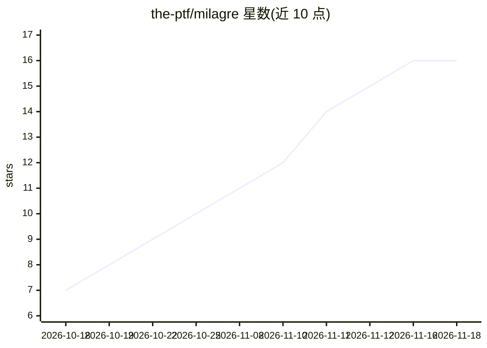

# the-ptf/milagre

⭐ 16 · JavaScript · MIT · 推送 2026-11-17 · [GitHub](https://github.com/the-ptf/milagre) · [官网](milagre.dev) · 组织维护

**桌面应用：在本机并行运行 Claude Code/Codex/Kiro 等 agent，手机远程审批**

开源桌面应用（Electron），在用户电脑上运行 Claude Code、Codex、Kiro 和 Antigravity 等 coding agent，每个 Chat 使用独立 Git Worktree 并关联 PR 与检查。当 agent 需要审批或回答时，可推送到桌面与配对的 iPhone/Android 手机；权限模式分 Ask/Auto/Full，可回滚到任意 checkpoint。无 Milagre 账号、无托管推理，agent 运行在用户自己的 provider 账号上。提供 DMG/AppImage/DEB/RPM/安装包、brew cask 及 npx CLI 的无 UI 服务器模式；开发需 Node.js 24+。

## 筛选速览

| 维度 | 判定 | 备注 |
|---|---|---|
| AI 角色 | `ai-ecosystem` | LLM/agent 周边工具 |
| 许可风险 | `permissive` | MIT |
| 部署形态 | `library` | 以包/库形式分发 |
| 模型依赖 | — | README 未给出锁定关系 |
| 硬件要求 | — | 无带数字的原话,不猜 |
| 安装摩擦 | `low` | 无编译、无系统依赖或容器化 |
| 成熟度 | — | 结构信号不足 |

## 能力要点

- 每个 Chat 独立 Git Worktree，并行运行多个 agent
- 审批与回复可推送到 iPhone/Android 手机
- Ask/Auto/Full 权限模式与 checkpoint 回滚
- 支持 npx milagre serve 的无 UI 服务器模式

## 适用场景

- 同时跑多个 coding agent 会话并管理各自的工作区
- 离开电脑时用手机审批 agent 的操作请求
- 在一台机器上让多个 agent 项目互相委派任务

## 场景标签

`编码 Agent` `多智能体` · 领域:Agent 开发

## 证据(README 行号)

> L9: Milagre is a free, open-source desktop app that runs Claude Code, Codex, Kiro and Antigravity on your computer, each
> L11: - **Parallel Chats.** Each Chat gets its own Worktree, with its pull request and checks beside it.

## 星数曲线

2026-10-18 7 → 2026-11-18 16（+9）

---
*卡片 v1 · prompt 1.4 · 生成 2026-11-18 · 置信度 high · 依据 README sha `dcbc0df4074e` · [字段定义](../../DATASET.md)*
