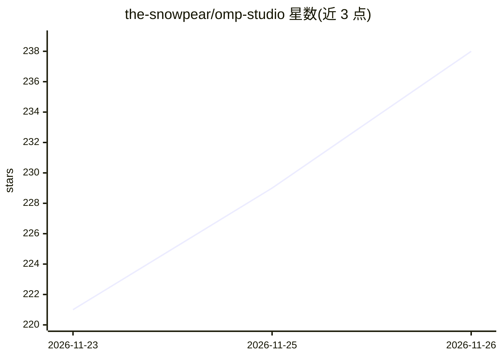

# the-snowpear/omp-studio

⭐ 238 · TypeScript · MIT · 推送 2026-11-25 · [GitHub](https://github.com/the-snowpear/omp-studio) · [官网](https://the-snowpear.github.io/omp-studio/) · 个人维护 · 中文 README

**oh-my-pi AI 编码 Agent 的跨平台桌面 GUI 工作台**

基于 Electron 与 React 的桌面应用，为 oh-my-pi（omp）编码 Agent 提供图形外壳：多会话并行对话、子 Agent 管理、审批、Git/Worktree、终端、托管浏览器、Computer Use、MCP/Skills 与 SSH/WSL 2 工作区集成在同一窗口。通过类型化 Studio Bridge 对接 Runtime，不解析 TUI 文本或模拟按键；界面元素可拖拽为浮窗、吸附分屏或钉成独立系统窗口，布局重启后恢复。另提供独立 Web 工作台（含局域网 HTTPS 访问与设备配对）。模型与登录沿用 OMP 的 models.yml / omp login，仓库不内置供应商密钥。

## 筛选速览

| 维度 | 判定 | 备注 |
|---|---|---|
| AI 角色 | `ai-ecosystem` | LLM/agent 周边工具 |
| 许可风险 | `permissive` | MIT |
| 部署形态 | `desktop` | 安装包/桌面程序 |
| 模型依赖 | — | README 未给出锁定关系 |
| 硬件要求 | — | 无带数字的原话,不猜 |
| 安装摩擦 | `low` | 无编译、无系统依赖或容器化 |
| 成熟度 | — | 结构信号不足 |

## 能力要点

- 窗口化工作台：对话与工具可拖成浮窗、吸附分屏、钉成独立系统窗口
- 类型化 Studio Bridge 直接对接 Runtime，Renderer 不持有 token 与进程句柄
- 内置 Git、终端、托管浏览器、Computer Use、SSH/WSL 2 工作区、评测与语音输入
- 独立 Web 工作台支持局域网 HTTPS、设备配对与接管

## 适用场景

- 在图形界面同时运行多场编码 Agent 对话并逐场审批计划
- 在桌面上集中管理子 Agent 的状态、Token 用量与花费
- 通过浏览器或手机在局域网内接管本机项目会话
- 用 Time Travel 按回合快照恢复代码或对话

## 场景标签

`编码 Agent` · 领域:编码与开发

## 证据(README 行号)

> L26: **OMP Studio** 是 oh-my-pi（`omp`）AI Coding Agent 的跨平台桌面 GUI 与可视化工作台（支持 Windows、macOS 与 Linux）。它基于 Electron 与 React，将
> L330: 支持 OMP 能连接的全部供应商，例如 Anthropic、OpenAI、OpenRouter、本地 LM Studio 等。密钥和登录走 OMP 的 `models.yml` / `omp login`，本仓库不内置任何密钥。

## 星数曲线

2026-11-23 221 → 2026-11-26 238（+17）

---
*卡片 v1 · prompt 1.4 · 生成 2026-11-26 · 置信度 high · 依据 README sha `d083ee035468` · [字段定义](../../DATASET.md)*
