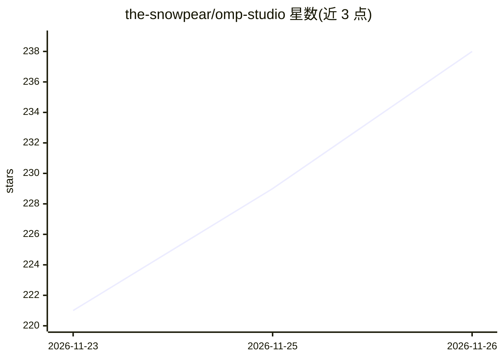

# the-snowpear/omp-studio

⭐ 238 · TypeScript · MIT · 推送 2026-11-25 · [GitHub](https://github.com/the-snowpear/omp-studio) · [官网](https://the-snowpear.github.io/omp-studio/) · 组织维护 · 中文 README

**oh-my-pi AI 编码 Agent 的跨平台桌面工作台 GUI**

基于 Electron 与 React 的桌面应用，为 oh-my-pi（omp）编码 Agent 提供可视化外壳：多会话并行对话、审批、子 Agent 管理、Git/Worktree、文件、终端、托管浏览器、Computer Use、MCP/Skills 配置与 SSH/WSL 2 工作区集成在同一窗口。对话与工具窗口可浮动、吸附分屏、钉成独立系统窗口，布局重启后恢复。通过类型化 Studio Bridge 直连 Runtime，不解析 TUI 文本。提供 Windows/macOS/Linux 安装包，也可从源码运行；模型密钥沿用 OMP 的 models.yml，仓库不内置密钥。

## 筛选速览

| 维度 | 判定 | 备注 |
|---|---|---|
| AI 角色 | `ai-ecosystem` | LLM/agent 周边工具 |
| 许可风险 | `permissive` | MIT |
| 部署形态 | `desktop` | 安装包/桌面程序 |
| 模型依赖 | — | README 未给出锁定关系 |
| 硬件要求 | — | 无带数字的原话,不猜 |
| 安装摩擦 | `low` | 无编译、无系统依赖或容器化 |
| 成熟度 | `idea` | |

## 能力要点

- 可拖拽的窗口化工作台：5 种停靠位置、6 种分屏模板、钉成独立窗口
- 通过类型化 Studio Bridge 直接对接 omp Runtime，不模拟按键或解析 TUI 输出
- Agent Hub 集中查看子 Agent 状态、Token 用量与花费；Time Travel 按回合快照恢复
- 同一页管理 Skills/Plugins/MCP/Slash Commands 与多供应商模型配置

## 适用场景

- 并行开多场编码对话，分屏查看命令执行、审批与提问
- 在 GUI 里管理子 Agent、模型供应商与 MCP/Skills 配置
- 通过 SSH 或 WSL 2 在远端项目上运行 Agent 并使用 Git 与终端

## 场景标签

`编码 Agent` · 领域:编码与开发

## 证据(README 行号)

> L24: **OMP Studio** 是 oh-my-pi（`omp`）AI Coding Agent 的跨平台桌面 GUI 与可视化工作台（支持 Windows、macOS 与 Linux）。它基于 Electron 与 React，将
> L264: OMP Studio 是 omp 的桌面外壳。模型、登录、Skills 和会话都沿用 OMP 自己的配置与格式；Studio 通过 Bridge 调用 Runtime 的语义能力，不包装终端。上游 OMP 的缺陷请提交到 can

## 星数曲线

2026-11-23 221 → 2026-11-26 238（+17）

---
*卡片 v1 · prompt 1.4 · 生成 2026-11-25 · 置信度 high · 依据 README sha `7c8c21c8fb0f` · [字段定义](../../DATASET.md)*
