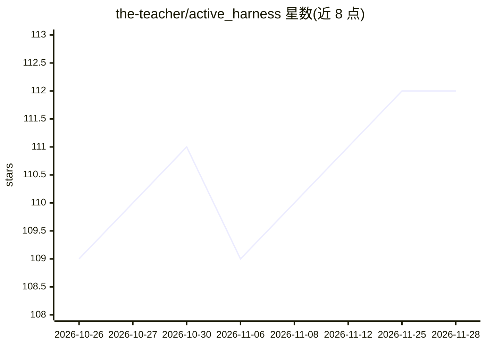

# the-teacher/active_harness

⭐ 112 · Ruby · MIT · 推送 2026-11-24 · [GitHub](https://github.com/the-teacher/active_harness) · 个人维护

**给 Ruby/Rails 开发者的 LLM 流水线构建框架**

ActiveHarness 是一个 Ruby gem，为构建生产级 LLM 流水线提供脚手架：Request 封装单次可靠调用（模型链、fallback、重试、钩子），Pipeline 支持多步、嵌套与确定性/LLM 混合编排，Tribunal 通过多请求并行取共识结果，Tool 提供默认拒绝的安全工具调用，Agent 运行带目标检查与轮次限制的工具循环。内置 token/费用/耗时追踪、SSE 流式、OpenTelemetry 事件追踪与 JSON/SQLite/PostgreSQL 记忆后端，提供 Rails 生成器，也可在纯 Ruby 中使用。

## 筛选速览

| 维度 | 判定 | 备注 |
|---|---|---|
| AI 角色 | `ai-ecosystem` | LLM/agent 周边工具 |
| 许可风险 | `permissive` | MIT |
| 部署形态 | `None` |  |
| 模型依赖 | — | README 未给出锁定关系 |
| 硬件要求 | — | 无带数字的原话,不猜 |
| 安装摩擦 | `low` | 无编译、无系统依赖或容器化 |
| 成熟度 | `idea` | |

## 能力要点

- 多步/嵌套/混合流水线编排，含每步停止条件与上下文转发
- Tribunal 共识机制：多请求并行，按一致/多数/自定义策略取 Verdict
- 默认拒绝的 Tool 体系与带 goal check 的 Agent 循环
- 基于 OpenTelemetry 的事件追踪与实时 token/费用追踪

## 适用场景

- 在 Rails 应用中搭建可靠、可观测的多步 LLM 工作流
- 对关键 LLM 输出做多模型共识以降低幻觉
- 为模型提供受限的文件读取等工具并控制风险
- 追踪并控制每次 AI 调用的 token 与费用

## 场景标签

`LLM 可观测性` `Agent 框架` · 领域:Agent 开发

## 证据(README 行号)

> L13: **ActiveHarness** is a Ruby framework for building production-grade LLM pipelines — with deep observability, consen
> L15: ActiveHarness gem gives you the scaffolding to build multi-step pipelines where every request is under full control

## 星数曲线

2026-10-26 109 → 2026-11-28 112（+3）

---
*卡片 v1 · prompt 1.4 · 生成 2026-11-28 · 置信度 high · 依据 README sha `aeeb75a0f56d` · [字段定义](../../DATASET.md)*
