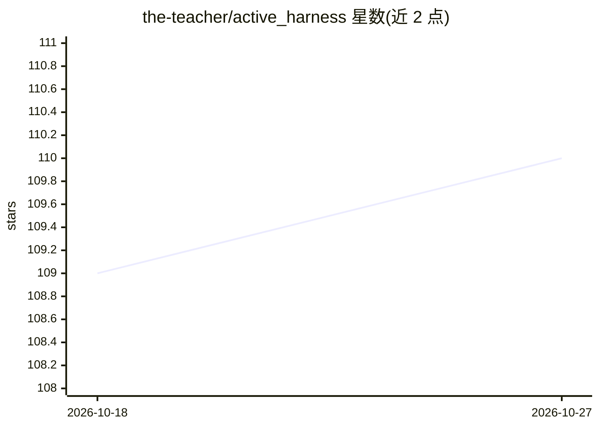

# the-teacher/active_harness

⭐ 110 · Ruby · MIT · 推送 2026-10-23 · [GitHub](https://github.com/the-teacher/active_harness) · 个人维护

**面向 Ruby/Rails 的 LLM 流水线构建框架**

以 Ruby gem 形式提供的 LLM 应用框架，为 Rails 提供原生 DSL，也可在纯 Ruby 中使用。核心机制：Request 封装单次韧性 LLM 调用（模型链、回退、指数退避重试、生命周期钩子），Pipeline 支持多步与嵌套编排，可混合确定性 Ruby 步骤与模型步骤；Tribunal 并行多请求做共识裁决；Tool 提供类型化、默认拒绝的模型工具调用，Agent 是带目标检查与限额的工具循环。内置 token/成本/耗时追踪、SSE 流式输出、JSON/SQLite/PostgreSQL 记忆存储，观测基于 OpenTelemetry。README 明确标注 API 处于开发中，可能随版本变更；Agent 抽象为第一迭代。

## 筛选速览

| 维度 | 判定 | 备注 |
|---|---|---|
| AI 角色 | `ai-ecosystem` | LLM/agent 周边工具 |
| 许可风险 | `permissive` | MIT |
| 部署形态 | `None` |  |
| 模型依赖 | — | README 未给出锁定关系 |
| 硬件要求 | — | 无带数字的原话,不猜 |
| 安装摩擦 | `low` | 无编译、无系统依赖或容器化 |
| 成熟度 | `idea` | |

## 能力要点

- 模型链自动回退与按模型配置的指数退避重试
- Tribunal 共识机制：并行多请求按一致策略产出裁决
- 类型化、默认拒绝的 Tool 与带目标检查的 Agent 循环
- OpenTelemetry 事件追踪与 Grafana 指标；token/成本实时追踪

## 适用场景

- 在 Rails 应用中构建多步 LLM 流水线并追踪每步成本
- 通过并行共识裁决提升 LLM 输出可靠性
- 为模型提供受控工具与记忆，构建带目标检查的 Agent

## 场景标签

`Agent 框架` · 领域:Agent 开发

## 证据(README 行号)

> L13: **ActiveHarness** is a Ruby framework for building production-grade LLM pipelines — with deep observability, consen
> L15: ActiveHarness gem gives you the scaffolding to build multi-step pipelines where every request is under full control

## 星数曲线

2026-10-18 109 → 2026-10-27 110（+1）

---
*卡片 v1 · prompt 1.4 · 生成 2026-10-23 · 置信度 high · 依据 README sha `89021bee655b` · [字段定义](../../DATASET.md)*
