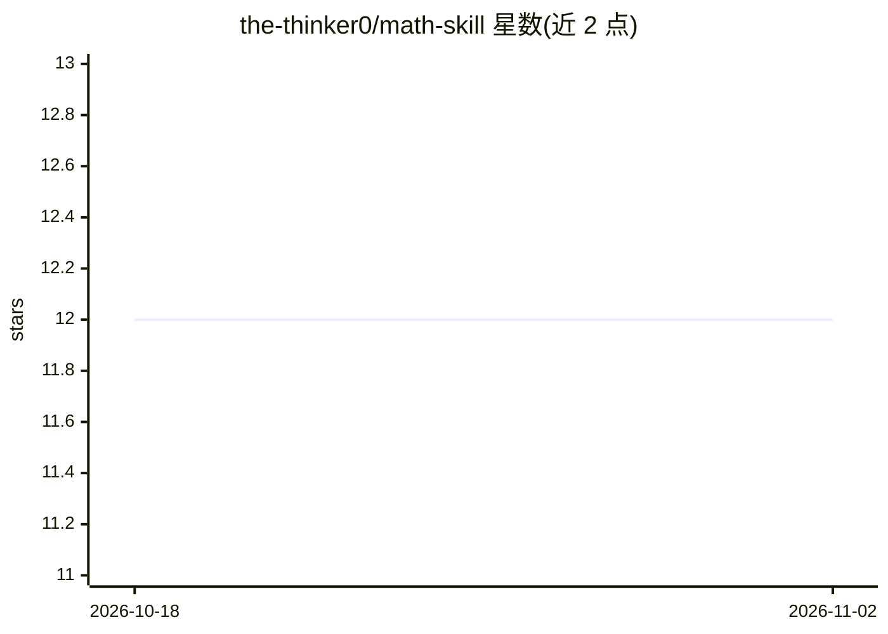

# the-thinker0/math-skill

⭐ 12 · JavaScript · MIT · 推送 2026-09-15 · [GitHub](https://github.com/the-thinker0/math-skill) · 个人维护 · 中文 README

**面向 AI 编程助手的数学研究技能包：透镜/锚点/设计模式知识库**

以 npm 包与 Agent Skills 形式分发的数学推理知识系统，供 Claude Code、Codex、Cursor、DeepSeek Harness (dsh) 等 AI 助手加载使用。内容按三层组织：15 个思想透镜、41 个激活锚点（37 共用数学 + 4 密码学）、22 个设计翻译模式，附 10 本数学/密码学书稿蒸馏文件。内置 Domain Router 在调用透镜前判定问题归属（AI 研究/密码学/共用数学/交叉），控制加载范围与 token 消耗。通过 npx 安装器安装到各平台，含 doctor 检查与评测脚本。限制：Windows 原生环境仍需验证，tests 不随 npm 分发。

## 筛选速览

| 维度 | 判定 | 备注 |
|---|---|---|
| AI 角色 | `ai-knowledge` | 知识聚合/清单类 |
| 许可风险 | `permissive` | MIT |
| 部署形态 | `library` | 以包/库形式分发 |
| 模型依赖 | locked-api |  |
| 硬件要求 | — | 无带数字的原话,不猜 |
| 安装摩擦 | `low` | 无编译、无系统依赖或容器化 |
| 成熟度 | — | 结构信号不足 |

## 能力要点

- 三层结构：15 透镜 + 41 锚点 + 22 设计模式，按需渐进加载
- Domain Router 判定 AI/密码学/共用数学路径，隔离跨域加载
- 10 本书稿（7 本 AI 方向 + 3 本密码学方向）双语蒸馏文件随包发布
- npx 安装器支持 claude/codex/dsh 等平台，doctor 检查安装完整性

## 适用场景

- 在 AI 架构设计中把研究目标形式化为数学构造并验证
- 密码学证明与安全归约的审查（PRF→MAC、攻击游戏框架）
- 跨数学领域寻找结构迁移思路并核验对象对应
- 让编程助手在数学问题上按需加载相应知识锚点

## 场景标签

`科研工具` · 领域:学习与行业

## 证据(README 行号)

> L15: 面向 **Claude Code / Codex / Cursor / DeepSeek Harness (dsh) 等** 的数学推理技能——在 AI 架构设计、数学结构迁移和密码学证明审查中，将模糊目标形式化，构造算子与验证方
> L98: |层|职责|目录|文件数|
> L108: - `references/books/*.md`：10 本书蒸馏稿（7 本 AI 方向 + 3 本密码学方向），需要深入时的完整上下文

## 星数曲线

2026-10-18 12 → 2026-11-02 12（+0）

---
*卡片 v1 · prompt 1.4 · 生成 2026-10-31 · 置信度 high · 依据 README sha `d2012db80715` · [字段定义](../../DATASET.md)*
