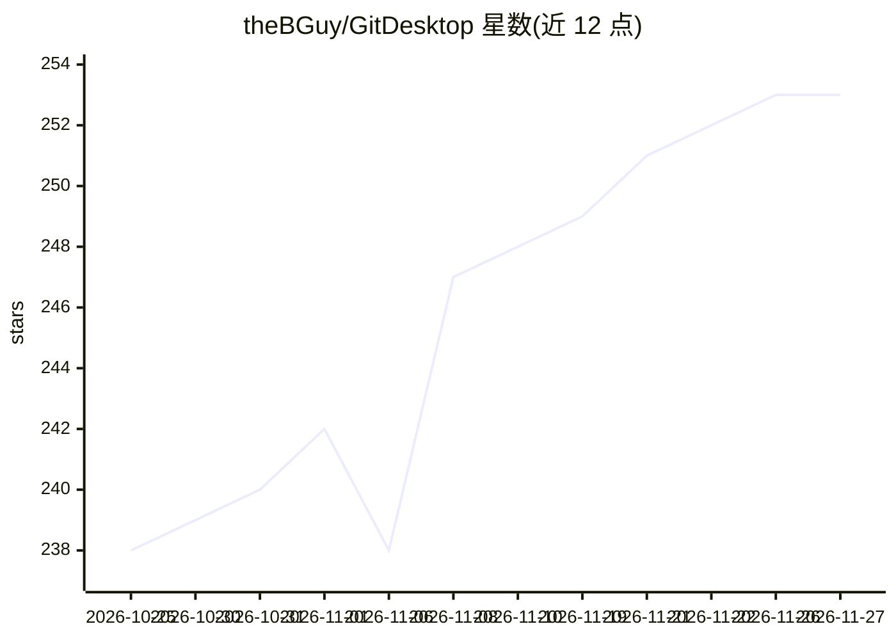

# theBGuy/GitDesktop

⭐ 253 · TypeScript · Apache-2.0 · 推送 2026-11-26 · [GitHub](https://github.com/theBGuy/GitDesktop) · [官网](https://gitdesktop.app) · 个人维护

**键盘优先的 Git 桌面客户端，覆盖 PR/CI 全流程**

基于 Tauri 2 与 React 19 的开源（Apache-2.0）跨平台 Git 桌面客户端，支持 Windows/macOS/Linux。功能覆盖暂存、diff、分支、历史等 git 操作，以及在应用内完成 GitHub/GitLab/Bitbucket 的 PR/MR 全流程（review、approve、merge）与 GitHub Actions 运行管理；还提供离线本地 PR、worktree 管理、交互式 rebase 等深度 git 工具。AI 部分为可选：AI 提交信息、AI review、Actions 调试，支持本地模型，可通过开关隐藏全部 AI 界面。GitHub 访问全部经 gh CLI，不存储令牌。

## 筛选速览

| 维度 | 判定 | 备注 |
|---|---|---|
| AI 角色 | `ai-enhanced` | 去掉 AI 部分产品仍成立 |
| 许可风险 | `permissive` | Apache-2.0 |
| 部署形态 | `self-host` | docker 或自建部署 |
| 模型依赖 | local-ok | 支持本地模型 |
| 硬件要求 | — | 无带数字的原话,不猜 |
| 安装摩擦 | `low` | 无编译、无系统依赖或容器化 |
| 成熟度 | — | 结构信号不足 |

## 能力要点

- 应用内完成 GitHub/GitLab/Bitbucket 的 PR review、approve、merge 全流程
- 离线本地 PR 与 GitHub Actions 运行驾驶舱（过滤、重跑、取消、日志）
- 可将任务交给 Claude Code/Codex/Copilot/opencode，在隔离 worktree 或容器中执行
- AI 功能可选，一键隐藏全部 AI 界面，支持本地模型

## 适用场景

- 在一个客户端里管理多个 forge 仓库的 PR、issue 与 CI
- 不动浏览器完成代码审查与合并
- 把编码任务交给 agent 并以分支或本地 PR 收回结果

## 场景标签

`代码审查` · 领域:编码与开发

## 证据(README 行号)

> L11: GitDesktop is a free, open-source (Apache-2.0) Git client for Windows, macOS,
> L20: AI runs through commits, reviews, and CI debugging, with the provider you
> L21: choose (local models included). It's also optional: one switch hides every AI

## 星数曲线

2026-10-25 238 → 2026-11-27 253（+15）

---
*卡片 v1 · prompt 1.4 · 生成 2026-11-26 · 置信度 mid · 依据 README sha `735acf1e85aa` · [字段定义](../../DATASET.md)*
