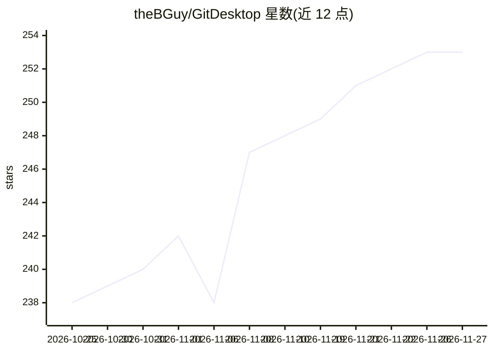

# theBGuy/GitDesktop

⭐ 253 · TypeScript · Apache-2.0 · 推送 2026-11-26 · [GitHub](https://github.com/theBGuy/GitDesktop) · [官网](https://gitdesktop.app) · 个人维护

**键盘优先的 AI Git 桌面客户端，覆盖 PR/CI/issue 管理**

基于 Tauri 2 + React 19 的跨平台（Windows/macOS/Linux）开源 Git 客户端，Apache-2.0 许可。功能覆盖暂存、diff、分支、rebase、worktree 管理、离线本地 PR、GitHub Actions 运行管理，以及 GitHub/GitLab/Bitbucket 三大代码托管的 PR/CI/issue 流程（Bitbucket issue 经 Jira）。AI 部分包括提交信息生成、迭代式代码审查、CI 失败调试，并可将任务交给 Claude Code/Codex/Copilot/opencode 等编码 agent 在隔离 worktree 或容器中执行；支持本地模型，AI 界面可用开关整体隐藏。所有 GitHub 访问经 `gh` CLI 完成，不存储 token。

## 筛选速览

| 维度 | 判定 | 备注 |
|---|---|---|
| AI 角色 | `ai-native` | 本体是模型或模型工具 |
| 许可风险 | `permissive` | Apache-2.0 |
| 部署形态 | `self-host` | docker 或自建部署 |
| 模型依赖 | local-ok | 支持本地模型 |
| 硬件要求 | — | 无带数字的原话,不猜 |
| 安装摩擦 | `low` | 无编译、无系统依赖或容器化 |
| 成熟度 | `idea` | |

## 能力要点

- 三大代码托管平台（GitHub/GitLab/Bitbucket）的 PR/CI 一体化管理
- AI 提交信息、迭代审查与 CI 调试，支持本地模型，可一键隐藏 AI 界面
- 离线本地 PR：任意两分支间生成可一键提升为真实 PR
- 双向 MCP：自带 MCP server，或将仓库只读暴露给 Claude Desktop/Cursor/Claude Code

## 适用场景

- 不打开浏览器完成代码审查、评论、批准与合并
- 用一个收件箱跨仓库、跨平台跟踪 PR/issue/审查请求
- 把编码任务交给 agent 在隔离 worktree 中执行并保留结果分支
- 在本地管理 GitHub Actions 运行、日志与失败重跑

## 场景标签

`代码审查` `编码 Agent` · 领域:编码与开发

## 证据(README 行号)

> L11: GitDesktop is a free, open-source (Apache-2.0) Git client for Windows, macOS,
> L20: AI runs through commits, reviews, and CI debugging, with the provider you
> L21: choose (local models included). It's also optional: one switch hides every AI

## 星数曲线

2026-10-25 238 → 2026-11-27 253（+15）

---
*卡片 v1 · prompt 1.4 · 生成 2026-11-27 · 置信度 mid · 依据 README sha `c67a3d31a8dc` · [字段定义](../../DATASET.md)*
