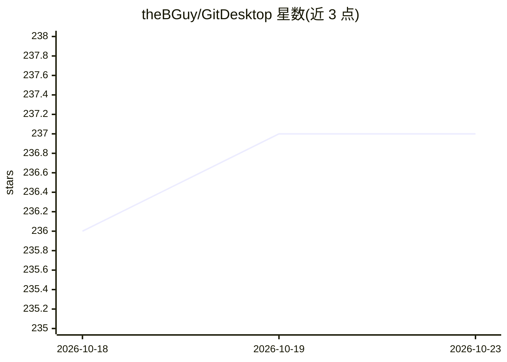

# theBGuy/GitDesktop

⭐ 237 · TypeScript · Apache-2.0 · 推送 2026-10-22 · [GitHub](https://github.com/theBGuy/GitDesktop) · [官网](https://gitdesktop.app) · 个人维护

**键盘优先的 AI 增强型 Git 桌面客户端，覆盖三大平台全 PR 流程**

基于 Tauri 2 + React 19 的开源（Apache-2.0）Git 桌面客户端，支持 Windows/macOS/Linux。核心是 Git 操作与 PR 全流程（评审、评论、合并）在应用内完成，覆盖 GitHub、GitLab、Bitbucket 三家，含 GitHub Actions 面板、离线本地 PR、worktree 管理器与分支高级操作。GitHub 访问全部通过 GitHub CLI（gh）完成，不存令牌。AI 能力（提交信息生成、AI 评审、Agent 委派、MCP 双向）为可选，一个开关可隐藏全部 AI 界面，保留纯 Git 客户端功能。

## 筛选速览

| 维度 | 判定 | 备注 |
|---|---|---|
| AI 角色 | `ai-enhanced` | 去掉 AI 部分产品仍成立 |
| 许可风险 | `permissive` | Apache-2.0 |
| 部署形态 | `self-host` | docker 或自建部署 |
| 模型依赖 | local-ok | 支持本地模型 |
| 硬件要求 | — | 无带数字的原话,不猜 |
| 安装摩擦 | `low` | 无编译、无系统依赖或容器化 |
| 成熟度 | — | 结构信号不足 |

## 能力要点

- GitHub/GitLab/Bitbucket 三平台 PR 全流程应用内完成
- GitHub Actions 运行面板：查看/重跑/取消/失败日志与 AI 调试
- 向 Claude Code、Codex、Copilot、opencode 委派任务于隔离 worktree 或容器
- MCP 双向：自带服务器接入或以只读方式向 Claude Desktop/Cursor 暴露仓库
- GitHub 访问全部经由 gh CLI，不存储令牌

## 适用场景

- 在桌面端完成跨 GitHub/GitLab/Bitbucket 的评审与合并而不开浏览器
- 用 AI 生成提交信息、迭代式 AI 评审与安全审计
- 把编码任务交给 Claude Code 等 agent 并在隔离环境中监督其改动
- 管理多分支并行工作（worktree 管理器、本地 PR、分支清理）

## 场景标签

 · 领域:开发者工具/Git 桌面客户端

## 证据(README 行号)

> L20: AI runs through commits, reviews, and CI debugging, with the provider you
> L21: choose (local models included). It's also optional: one switch hides every AI
> L22: surface, leaving a keyboard-first Git client.

## 星数曲线

2026-10-18 236 → 2026-10-23 237（+1）

---
*卡片 v1 · prompt 1.4 · 生成 2026-10-22 · 置信度 mid · 依据 README sha `f6ec0781a128` · [字段定义](../../DATASET.md)*
