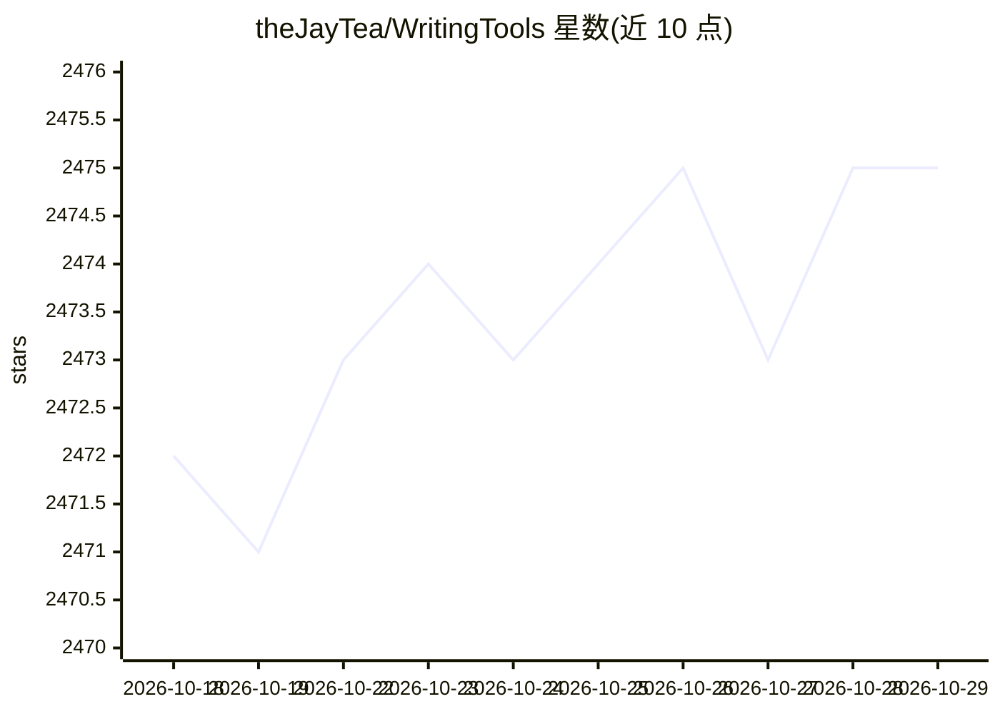

# theJayTea/WritingTools

⭐ 2,475 · Swift · GPL-3.0 · 推送 2026-08-19 · [GitHub](https://github.com/theJayTea/WritingTools) · 个人维护

**跨平台 AI 写作助手：快捷键全局润色、改写与摘要**

面向桌面用户的系统级 AI 写作工具，支持 Windows、Linux 与 macOS（原生 Swift 移植版）。按 ctrl+space 选中任意文本即可校对、改写、调整语气或按自定义指令处理，并可对网页、YouTube 转录等生成摘要弹窗与追问对话，支持自建按钮。模型接入包括免费 Gemini API、云端 LLM（OpenAI/Mistral/OpenRouter 等，经 OpenAI 兼容接口）及本地 LLM（Ollama、llama.cpp、KoboldCPP、TabbyAPI、vLLM、MLX）。API 密钥与配置仅存本地。Windows 提供绿色版，macOS 14+ 提供 dmg，Linux 需从源码运行（x11 支持较好，Wayland 有限制）。

## 筛选速览

| 维度 | 判定 | 备注 |
|---|---|---|
| AI 角色 | `ai-native` | 本体是模型或模型工具 |
| 许可风险 | `viral` | GPL-3.0 |
| 部署形态 | `desktop` | 安装包/桌面程序 |
| 模型依赖 | local-ok | 支持本地模型 |
| 硬件要求 | — | 无带数字的原话,不猜 |
| 安装摩擦 | `low` | 无编译、无系统依赖或容器化 |
| 成熟度 | — | 结构信号不足 |

## 能力要点

- 快捷键全局调用，校对/改写/语气调整/自定义指令
- 摘要功能可对话追问，支持 Markdown 渲染弹窗
- 接入免费 Gemini API、OpenAI 兼容云端 LLM 与多种本地 LLM
- macOS 版原生 Swift 实现，支持 MLX 本地推理与 RTF 格式保留

## 适用场景

- 在任意应用中一键校对或改写选中文本
- 用本地 LLM 离线处理敏感文本
- 快速摘要网页或 YouTube 视频转录并追问

## 场景标签

`AI 写作` · 领域:内容生成

## 证据(README 行号)

> L19: Writing Tools is an **Apple Intelligence-inspired application for Windows, Linux, and macOS that supercharges your 
> L21: With one hotkey press system-wide, it lets you fix grammar, optimize text according to your instructions, summarize
> L62: - **More intelligent than Apple's Writing Tools and Grammarly Premium:** Apple uses a tiny 3B parameter model, whil

## 星数曲线

2026-10-18 2,472 → 2026-10-29 2,475（+3）

---
*卡片 v1 · prompt 1.4 · 生成 2026-10-21 · 置信度 high · 依据 README sha `72394108c7d9` · [字段定义](../../DATASET.md)*
