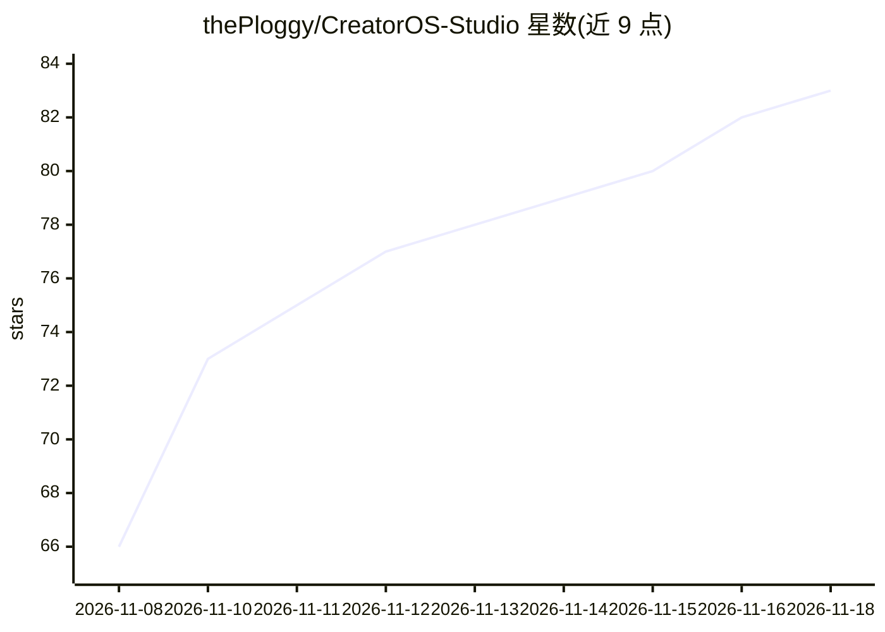

# thePloggy/CreatorOS-Studio

⭐ 83 · TypeScript · Apache-2.0 · 推送 2026-11-13 · [GitHub](https://github.com/thePloggy/CreatorOS-Studio) · [官网](https://forge.taila06702.ts.net:8443) · 个人维护

**本地 GPU 角色视频工作室：训练固定角色并产出成片**

运行在本地 ComfyUI 之上的开源视频/图像生成工作室：在界面内训练角色身份 LoRA（FLUX.2 Klein/Krea 2，经 ai-toolkit），同一角色贯穿照片、片段与成片；一行简介经本地 LLM（Ollama）规划分镜，逐镜头拍摄、配音配乐并自动剪辑，单个镜头可单独重渲。提供 62 个功能、118 个预设、3D 场景调度、草图生视频、老素材修复（SeedVR2）等，全部使用开放权重模型、无 API 调用。照片与图生视频在 8/12/16 GB 显存卡上以更轻权重运行；含 MCP server 供 Claude 等 MCP 客户端驱动。演示跑在作者 RTX 5090 上，含未成年与裸露拒绝、NudeNet 检测等安全机制。

## 筛选速览

| 维度 | 判定 | 备注 |
|---|---|---|
| AI 角色 | `ai-native` | 本体是模型或模型工具 |
| 许可风险 | `permissive` | Apache-2.0 |
| 部署形态 | `library` | 以包/库形式分发 |
| 模型依赖 | local-ok | 支持本地模型 |
| 硬件要求 | — | 无带数字的原话,不猜 |
| 安装摩擦 | `medium` | 含编译或系统依赖之一 |
| 成熟度 | — | 结构信号不足 |

## 能力要点

- 界面内训练角色身份 LoRA，同一角色贯穿照片、片段与成片
- 一行简介由本地 LLM 规划分镜并自动剪辑成 reel，单镜头可独立重渲
- 62 个功能 / 118 个预设 / 25 个内置配方，并可导入 262 个官方 ComfyUI 工作流
- 仅开放权重模型本地运行，8 GB 显存可跑照片与图生视频
- 提供 15 个工具的 MCP server 与 agent skill，供 Claude 等 MCP 客户端调用

## 适用场景

- 打造并持续使用同一个虚拟角色拍摄照片和短视频
- 把一句创意简介变成带配乐、配音和转场的成品 reel
- 修复老照片或受损影片并上色、提升清晰度
- 通过 MCP 让 Claude 等 agent 直接操作视频工作室

## 场景标签

`视频生成` `图像生成` `微调` `图像视频处理` · 领域:内容生成

## 证据(README 行号)

> L3: **An open-source Higgsfield you run at home: one recurring character, from a one-line brief to a finished, edited re
> L19: Built for the Comfy **#OpenSourceHiggsfield** challenge. Every model is open weights and runs locally: no API call,
> L85: - **One-click reel**: write a brief ("a Sunday morning in Paris, golden light"). A local LLM plans 3 to 6 shots of 

## 星数曲线

2026-11-08 66 → 2026-11-18 83（+17）

---
*卡片 v1 · prompt 1.4 · 生成 2026-11-18 · 置信度 high · 依据 README sha `c9a3a918b2b5` · [字段定义](../../DATASET.md)*
