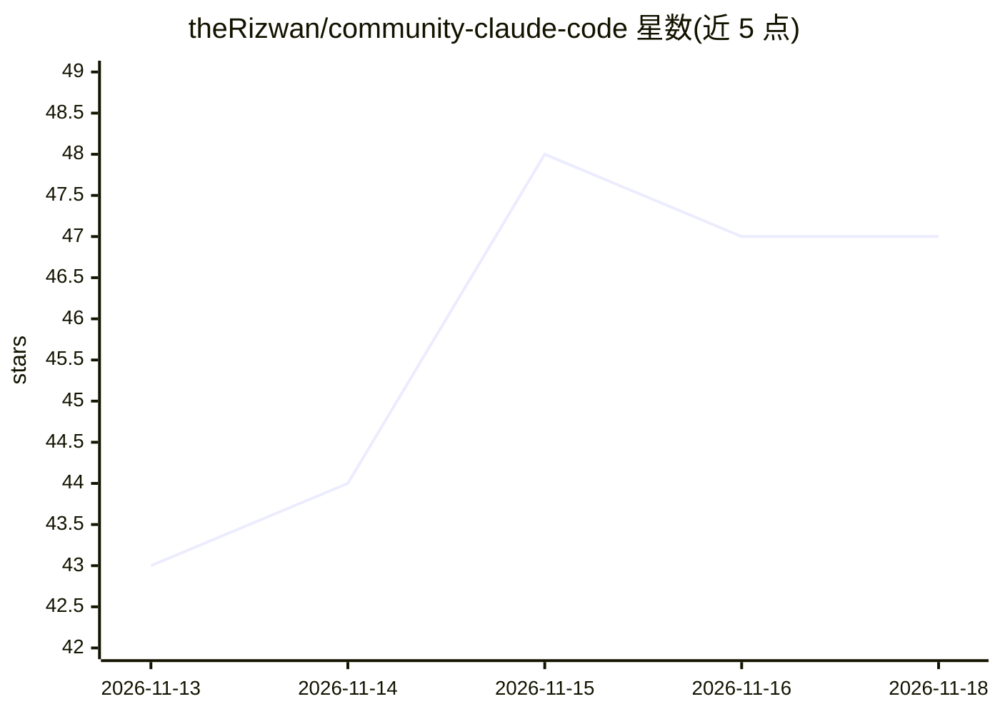

# theRizwan/community-claude-code

⭐ 47 · Python · NOASSERTION · 推送 2026-11-16 · [GitHub](https://github.com/theRizwan/community-claude-code) · 个人维护

**连接编码 agent 与任意 OpenAI 兼容模型的本地代理网关**

本地运行的代理服务：将 Claude Code、Codex、Cline、Aider 等编码 agent 路由到 60 余个 AI 提供商（NVIDIA NIM、OpenRouter、Anthropic、Azure OpenAI、Bedrock、本地 Ollama/llama.cpp 等），保留原生流式输出、工具调用与交错思考。可靠性机制包括自动重试、可配置限流与并发控制、模型/提供商回退及多 API key 回退；支持终端、桌面应用、IDE 插件、Discord/Telegram（含语音笔记）与浏览器会话，并通过 RTK 与 Headroom 降低 token 用量。AGPL v3 许可，独立项目、与 Anthropic 无关联。

## 筛选速览

| 维度 | 判定 | 备注 |
|---|---|---|
| AI 角色 | `ai-ecosystem` | LLM/agent 周边工具 |
| 许可风险 | `none` | NOASSERTION |
| 部署形态 | `None` |  |
| 模型依赖 | local-ok | 支持本地模型 |
| 硬件要求 | — | 无带数字的原话,不猜 |
| 安装摩擦 | `medium` | 含编译或系统依赖之一 |
| 成熟度 | — | 结构信号不足 |

## 能力要点

- 路由 60+ 提供商，保留流式输出、工具调用与交错思考
- 自动重试、限流、并发控制、模型/提供商与多 key 回退
- 为 Claude Code、Codex、Cline、Aider 等 10+ 编码 agent 提供 ccc-* 启动命令
- 任意 Chat Completions 客户端可经 /v1 作为 OpenAI 兼容端点接入

## 适用场景

- 让 Claude Code 等编码 agent 使用其他提供商或本地模型
- 在提供商故障时靠自动回退与重试保持编码连续性
- 通过 RTK/Headroom 与多 key 轮换降低 token 消耗
- 在 Discord/Telegram 手机端以语音笔记驱动编码 agent

## 场景标签

`模型网关` · 领域:Agent 开发

## 证据(README 行号)

> L9: - Route any supported harness to models from any supported provider.
> L145: Other Chat Completions clients can use CCC's server URL followed by `/v1` as their OpenAI-compatible base URL (def
> L164: ProviderAdmin UI settingExample MODELNVIDIA NIMNVIDIA_NIM_API_KEYnvidia_nim/nvidia/nemotron-3-ultra-550b-a55bOpenR

## 星数曲线

2026-11-13 43 → 2026-11-18 47（+4）

---
*卡片 v1 · prompt 1.4 · 生成 2026-11-18 · 置信度 high · 依据 README sha `d4c6673ba937` · [字段定义](../../DATASET.md)*
