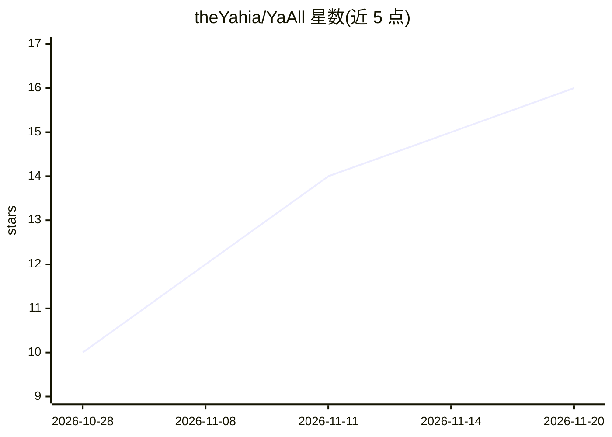

# theYahia/YaAll

⭐ 16 · TypeScript · MIT · 推送 2026-09-27 · [GitHub](https://github.com/theYahia/YaAll) · 个人维护

**为 MCP 客户端提供 10 个 Yandex 服务 MCP 服务器合集**

聚合仓库：自带 10 个 MCP 服务器（134 个工具）覆盖 Yandex Direct、Metrica、Webmaster、Wordstat、Tracker、360、Maps、SpeechKit、YandexGPT、AppMetrica，另含四套 Claude Code 技能（ЭПОС SEO 审计、Wordstat 需求验证等）及 Yandex 官方服务器文档快照。面向 PPC、SEO、分析、开发等角色，通过 npx 启动服务器，各服务器需各自的产品 API 密钥，数据从本地直接访问 Yandex API。upstream 目录为 Apache 2.0 快照，不接受 PR。

## 筛选速览

| 维度 | 判定 | 备注 |
|---|---|---|
| AI 角色 | `ai-ecosystem` | LLM/agent 周边工具 |
| 许可风险 | `permissive` | MIT |
| 部署形态 | `None` |  |
| 模型依赖 | — | README 未给出锁定关系 |
| 硬件要求 | — | 无带数字的原话,不猜 |
| 安装摩擦 | `low` | 无编译、无系统依赖或容器化 |
| 成熟度 | — | 结构信号不足 |

## 能力要点

- 10 个自研 MCP 服务器共 134 个工具，npm 发布为 @theyahia/*
- yandex-search-mcp 补足官方服务器缺失的 Wordstat 统计接口
- 4 套 Claude Code 技能：ЭПОС 站点审计与需求验证（GO/MAYBE-PILOT/RED）
- 集中梳理三套不同的密钥/角色授权机制

## 适用场景

- 让 Claude/Cursor 等助手直接操作 Yandex 广告与统计后台
- SEO 从业者做 ЭПОС 审计评估页面进入 Alice/Yandex AI Search 的可能
- 产品上线前用 Wordstat 数据验证 niche 需求
- 开发者接入 YandexGPT 与 SpeechKit 能力

## 场景标签

`数据分析` · 领域:效率与自动化

## 证据(README 行号)

> L7: Весь яндексовский слой для MCP в одном репозитории: **десять своих MCP-серверов**
> L17: MCP (Model Context Protocol) — способ дать ИИ-ассистенту прямой доступ к внешнему API.
> L18: Эти серверы подключают Claude, Cursor, VS Code и любой другой MCP-клиент к сервисам

## 星数曲线

2026-10-28 10 → 2026-11-20 16（+6）

---
*卡片 v1 · prompt 1.4 · 生成 2026-11-18 · 置信度 high · 依据 README sha `322a41d3157f` · [字段定义](../../DATASET.md)*
