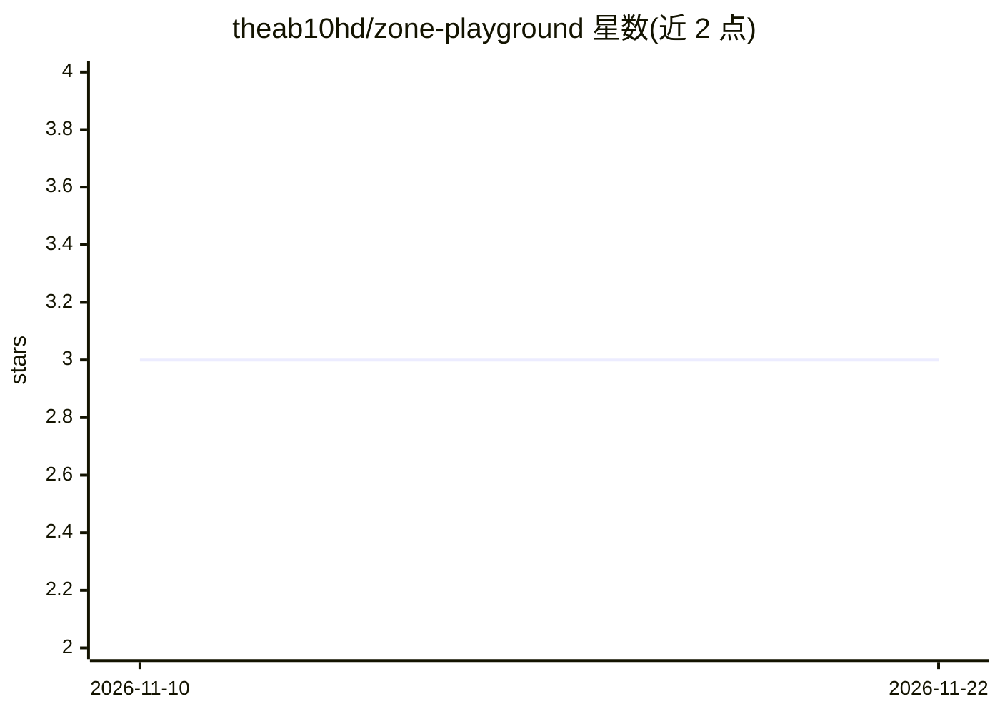

# theab10hd/zone-playground

⭐ 3 · JavaScript · 推送 2026-11-02 · [GitHub](https://github.com/theab10hd/zone-playground) · 个人维护

**面向 zOne 工作流的 Claude Code 插件集：规划开发、测试与工时填报**

一组运行在 Claude Code 内的插件，含四个模块：zDev 对照真实代码规划并构建功能、撰写 TRD 并导出 DOCX、复制后端 DLL；zOne Test 做 QA 代码评审并用 Playwright 设计、编写、运行 E2E 测试并生成 PDF 报告；zWork 处理 Azure DevOps 的 bug、任务与 PR（列表、评审、规划、修复、开 PR）；zOffice 将当日 Claude Code 会话整理为 zOffice 工时条目。变更应用代码前需用户确认，插件不存储密码或令牌。

## 筛选速览

| 维度 | 判定 | 备注 |
|---|---|---|
| AI 角色 | `ai-ecosystem` | LLM/agent 周边工具 |
| 许可风险 | `none` | — |
| 部署形态 | `library` | 以包/库形式分发 |
| 模型依赖 | — | README 未给出锁定关系 |
| 硬件要求 | — | 无带数字的原话,不猜 |
| 安装摩擦 | `low` | 无编译、无系统依赖或容器化 |
| 成熟度 | — | 结构信号不足 |

## 能力要点

- zDev 在 Opus 上只读规划、经用户批准后在 Sonnet/Opus 上构建
- zOne Test 自动设计并运行 Playwright E2E 套件，修复测试缺陷并输出 PDF 报告
- zWork 按状态展示 Azure DevOps bug/任务/PR 并支持分支修复与开 PR
- zOffice 从当日会话起草工时表，由用户自行提交

## 适用场景

- 对照真实代码库规划并实现新功能
- 为功能生成并运行 Playwright E2E 测试
- 在 Claude Code 中管理 Azure DevOps 工作项与 PR
- 把每日开发会话整理成工时表条目

## 场景标签

`编码 Agent` `代码审查` `浏览器自动化` `工作流自动化` · 领域:效率与自动化

## 证据(README 行号)

> L3: Claude Code plugins for zOne work: plan and build features, test them, handle Azure DevOps work and fill in the time
> L53: |`/zdev:plan <feature> [files, screenshots, PDFs, Figma links]`|Plans a feature with you on Opus, read-only: reads 

## 星数曲线

2026-11-10 3 → 2026-11-22 3（+0）

---
*卡片 v1 · prompt 1.4 · 生成 2026-11-21 · 置信度 mid · 依据 README sha `7924aeb6a4f6` · [字段定义](../../DATASET.md)*
