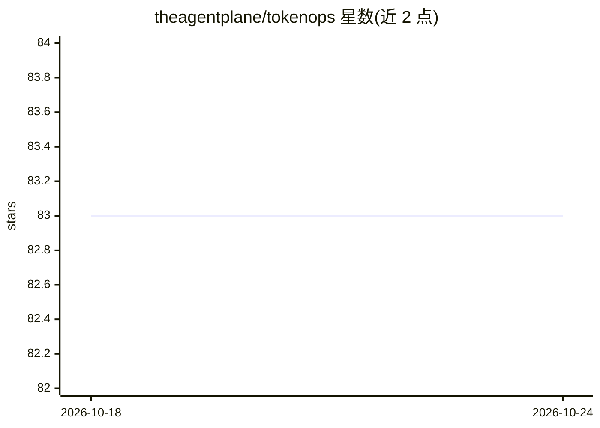

# theagentplane/tokenops

⭐ 83 · Python · MIT · 推送 2026-10-21 · [GitHub](https://github.com/theagentplane/tokenops) · [官网](https://theagentplane.github.io) · 组织维护

**面向多 agent 系统的运行级 token 预算治理库**

Python 库（PyPI 名 agent-tokenops）：为整个 agent 工作流设置单一预算，在每次模型调用前强制检查，超预算时抛出 Halt 中止运行；预算可进程内配置，也可通过 AgentPlane 控制平面跨进程共享。内置十种治理策略（含变更/注入下一跳调用等转向策略），工具调用计入预算，支持 FastAPI/A2A 服务插桩与 LangChain 示例。限制：本包不含服务器、数据库或 UI，共享账本依赖外部控制平面，无本地账本回退。

## 筛选速览

| 维度 | 判定 | 备注 |
|---|---|---|
| AI 角色 | `ai-ecosystem` | LLM/agent 周边工具 |
| 许可风险 | `permissive` | MIT |
| 部署形态 | `library` | 以包/库形式分发 |
| 模型依赖 | — | README 未给出锁定关系 |
| 硬件要求 | — | 无带数字的原话,不猜 |
| 安装摩擦 | `medium` | 含编译或系统依赖之一 |
| 成熟度 | — | 结构信号不足 |

## 能力要点

- run 级预算在每次模型调用前强制执行，超预算抛出 Halt
- 预算经控制平面跨进程共享（ETag 缓存拉取）
- 内置十种策略，支持变更/注入下一跳调用而非仅停止
- 零配置演示：python -m tokenops.demo 无需服务器与 API key

## 适用场景

- 为多 agent 工作流设置总预算并自动中止超支运行
- 在仪表盘中按 agent 归集成本（经 AgentPlane 控制平面）
- FastAPI / A2A 服务中插桩治理 token 支出

## 场景标签

`LLM 可观测性` · 领域:评测与运维

## 证据(README 行号)

> L36: a single budget for the whole workflow and enforces it before every step,
> L81: `wrap_complete` checks the budget before each call and raises `Halt` when the

## 星数曲线

2026-10-18 83 → 2026-10-24 83（+0）

---
*卡片 v1 · prompt 1.4 · 生成 2026-10-24 · 置信度 high · 依据 README sha `afe81f58e510` · [字段定义](../../DATASET.md)*
