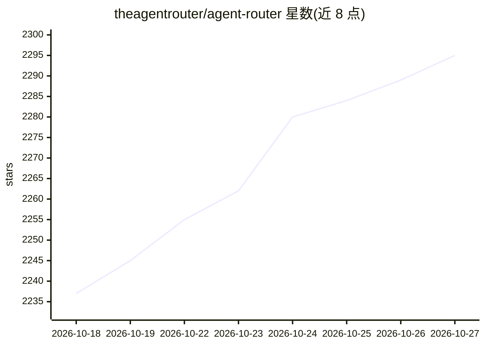

# theagentrouter/agent-router

⭐ 2,295 · Go · Apache-2.0 · 推送 2026-10-26 · [GitHub](https://github.com/theagentrouter/agent-router) · [官网](https://theagentrouter.ai/) · 组织维护

**基于 Envoy 的 AI 网关：统一接入各家模型与自托管推理**

原名 Envoy AI Gateway，现为 Agentic AI Foundation 项目。为应用团队提供单一 OpenAI 兼容 API，统一接入托管 LLM 服务商、自托管推理与 MCP 服务器；平台团队集中管理凭证、路由、配额、故障转移与用量归因，由 Envoy 与 Envoy Gateway 执行。采用两层网关模式：一层负责认证与全局限流，二层面向自托管模型集群的细粒度控制。可通过 aigw run 在本地独立运行，或经 Helm 部署到 Kubernetes。

## 筛选速览

| 维度 | 判定 | 备注 |
|---|---|---|
| AI 角色 | `ai-ecosystem` | LLM/agent 周边工具 |
| 许可风险 | `permissive` | Apache-2.0 |
| 部署形态 | `library` | 以包/库形式分发 |
| 模型依赖 | locked-api |  |
| 硬件要求 | — | 无带数字的原话,不猜 |
| 安装摩擦 | `low` | 无编译、无系统依赖或容器化 |
| 成熟度 | — | 结构信号不足 |

## 能力要点

- OpenAI 兼容的统一 API 接入多家服务商与自托管推理
- 两层网关模式：集中认证限流 + 自托管模型细粒度控制
- aigw run 单命令本地运行，OpenAI 客户端指向 localhost:1975/v1
- CRD、CLI、容器镜像与 Helm chart 自 Envoy AI Gateway 更名后均不变

## 适用场景

- 统一管理多家 LLM 服务商的接入凭证与路由
- Kubernetes 上为自托管模型集群做流量入口与限流
- 在本地用一条命令运行 OpenAI 兼容路由器做开发调试

## 场景标签

`模型网关` · 领域:Agent 开发

## 证据(README 行号)

> L7:  The open source control plane for AI and agent traffic, powered by Envoy.
> L18: Agent Router gives application teams one consistent, OpenAI-compatible API for every model and tool, from hosted pr

## 星数曲线

2026-10-18 2,237 → 2026-10-27 2,295（+58）

---
*卡片 v1 · prompt 1.4 · 生成 2026-10-21 · 置信度 high · 依据 README sha `3123fda3bc66` · [字段定义](../../DATASET.md)*
