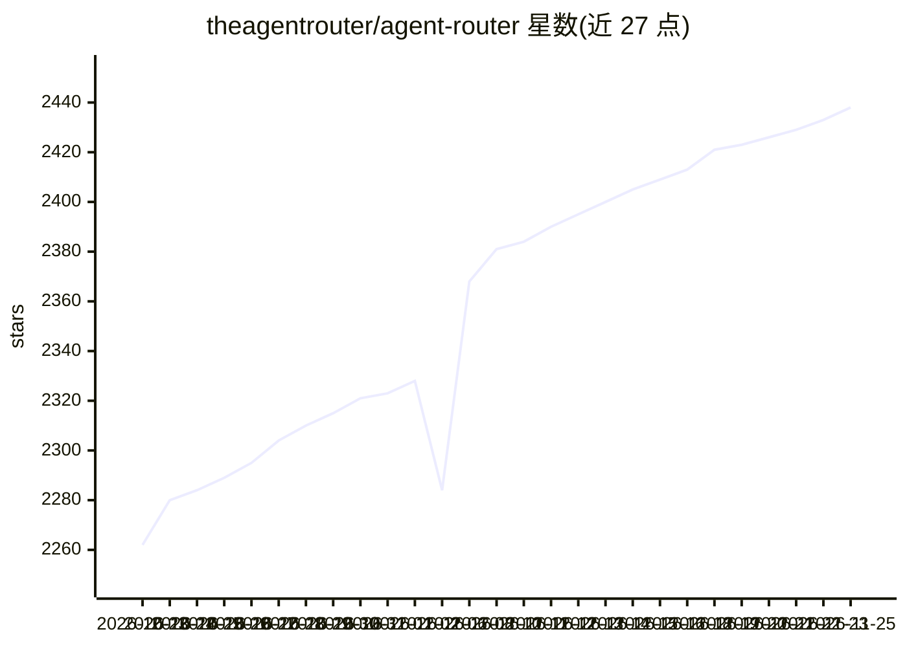

# theagentrouter/agent-router

⭐ 2,438 · Go · Apache-2.0 · 推送 2026-11-23 · [GitHub](https://github.com/theagentrouter/agent-router) · [官网](https://theagentrouter.ai/) · 组织维护

**为应用与平台团队统一接入生成式 AI 服务的 API 网关**

基于 Envoy Gateway 构建的 AI 流量控制平面，前身是 Envoy AI Gateway，现为 Agentic AI Foundation 项目。为应用团队提供统一的 OpenAI 兼容 API，覆盖托管服务商、自托管推理服务与 MCP 服务器；平台团队可在同一位置集中管理凭证、路由、配额、故障转移与用量归属。支持 Kubernetes 部署的两级网关模式，一级网关负责认证与全局限流，二级网关对自托管模型集群做细粒度控制。以 Go 模块、CLI（aigw）、容器镜像与 Helm chart 形式分发，采用 Apache 2.0 许可。

## 筛选速览

| 维度 | 判定 | 备注 |
|---|---|---|
| AI 角色 | `ai-ecosystem` | LLM/agent 周边工具 |
| 许可风险 | `permissive` | Apache-2.0 |
| 部署形态 | `library` | 以包/库形式分发 |
| 模型依赖 | locked-api |  |
| 硬件要求 | — | 无带数字的原话,不猜 |
| 安装摩擦 | `low` | 无编译、无系统依赖或容器化 |
| 成熟度 | — | 结构信号不足 |

## 能力要点

- 提供 OpenAI 兼容的统一 API，对接多种托管与自托管推理服务
- 集中管理凭证、路由、配额、failover 与用量归属
- 两级网关模式支持自托管模型集群与 endpoint picker
- 部署物延续原 Envoy AI Gateway 命名（CRD、CLI、镜像、Helm chart 不变）

## 适用场景

- 在 Kubernetes 上为多个模型服务商做统一入口与认证
- 为自托管模型推理集群做细粒度接入控制与限流
- 让应用通过一个 OpenAI 兼容端点访问不同 LLM 服务

## 场景标签

`模型网关` · 领域:Agent 开发

## 证据(README 行号)

> L7:  The open source control plane for AI and agent traffic, powered by Envoy.
> L18: Agent Router gives application teams one consistent, OpenAI-compatible API for every model and tool, from hosted pr
> L46: When using Agent Router, we refer to a two-tier gateway pattern. **The Tier One Gateway** functions as a centralize

## 星数曲线

2026-10-23 2,262 → 2026-11-25 2,438（+176）

---
*卡片 v1 · prompt 1.4 · 生成 2026-11-23 · 置信度 high · 依据 README sha `719e6184a771` · [字段定义](../../DATASET.md)*
