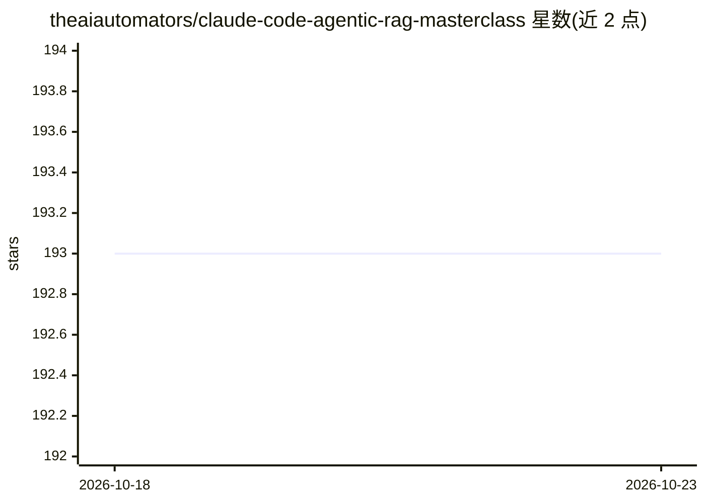

# theaiautomators/claude-code-agentic-rag-masterclass

⭐ 193 · 推送 2026-01-29 · [GitHub](https://github.com/theaiautomators/claude-code-agentic-rag-masterclass) · [官网](https://www.theaiautomators.com/) · 组织维护

**与 Claude Code 协作从零构建 RAG 应用的 8 模块视频课程**

由 The AI Automators 出品的实操课程：学习者不亲自写代码，而是引导 Claude Code 逐步构建完整的 agentic RAG 应用。8 个模块覆盖聊天界面、文档摄取、分块/嵌入/混合搜索/重排、text-to-SQL、Web 搜索与子代理等。技术栈为 React + FastAPI + Supabase（pgvector/Auth/Storage），模型可选本地 LM Studio 或云端 OpenAI/OpenRouter。仓库提供 PRD.md、CLAUDE.md、PROGRESS.md 等文档配套 YouTube 视频系列。明确面向无需编程基础但具备技术思维的学习者。

## 筛选速览

| 维度 | 判定 | 备注 |
|---|---|---|
| AI 角色 | `ai-knowledge` | 知识聚合/清单类 |
| 许可风险 | `none` | — |
| 部署形态 | `None` |  |
| 模型依赖 | locked-api |  |
| 硬件要求 | — | 无带数字的原话,不猜 |
| 安装摩擦 | `low` | 无编译、无系统依赖或容器化 |
| 成熟度 | — | 结构信号不足 |

## 能力要点

- 8 个模块：从应用外壳到子代理与混合搜索/重排
- 学习者引导 Claude Code 写代码，不要求会编程
- 技术栈 React + FastAPI + Supabase（pgvector）+ Docling
- 配套 PRD/CLAUDE/PROGRESS 文档与 YouTube 视频系列

## 适用场景

- 跟着视频系列学习构建生产级 RAG 系统
- 非程序员通过引导 Claude Code 实现完整 AI 应用
- 了解 agentic RAG 的模式（text-to-SQL、子代理、重排）

## 场景标签

`教程课程` · 领域:学习与行业

## 证据(README 行号)

> L3: Build an agentic RAG application from scratch by collaborating with Claude Code. Follow along with our video series 
> L11: A hands-on course where you collaborate with Claude Code to build a full-featured RAG system. You're not the one wr
> L33: ## The 8 Modules

## 星数曲线

2026-10-18 193 → 2026-10-23 193（+0）

---
*卡片 v1 · prompt 1.4 · 生成 2026-10-22 · 置信度 high · 依据 README sha `2ed64a016edc` · [字段定义](../../DATASET.md)*
