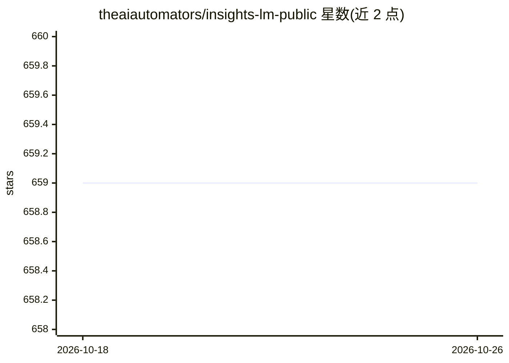

# theaiautomators/insights-lm-public

⭐ 659 · TypeScript · MIT · 推送 2026-01-16 · [GitHub](https://github.com/theaiautomators/insights-lm-public) · [官网](https://www.theaiautomators.com/) · 组织维护

**可自托管的 NotebookLM 替代品：文档问答与音频摘要**

面向终端用户的开源自托管 AI 研究工具，定位为 NotebookLM 替代品。上传文档后进行上下文感知的聊天问答，回答可溯源到原文位置；支持从资料生成播客式音频摘要。技术栈为 React/Vite/TypeScript 前端 + Supabase（数据库、认证、存储、Edge Functions）+ N8N（工作流后端），依赖 OpenAI、Gemini 等云 AI 服务；另有独立仓库提供基于 Ollama/Qwen3/Whisper 的完全本地版本。安装流程面向无代码用户，通过 Bolt.new 导入与配置，播客生成需在 n8n 服务器安装 FFMPEG。

## 筛选速览

| 维度 | 判定 | 备注 |
|---|---|---|
| AI 角色 | `ai-native` | 本体是模型或模型工具 |
| 许可风险 | `permissive` | MIT |
| 部署形态 | `self-host` | docker 或自建部署 |
| 模型依赖 | — | README 未给出锁定关系 |
| 硬件要求 | — | 无带数字的原话,不猜 |
| 安装摩擦 | `low` | 无编译、无系统依赖或容器化 |
| 成熟度 | — | 结构信号不足 |

## 能力要点

- 文档问答并将回答溯源到原文位置
- 从源资料生成播客式音频摘要
- 基于 Supabase + N8N + React 的自托管架构，数据自管
- 另提供 Ollama/Qwen3/Whisper/CoquiTTS 的完全本地版本仓库

## 适用场景

- 在私有知识库上做有据可查的问答研究
- 把内部资料转成音频摘要收听
- 自托管替代 NotebookLM 并按需定制

## 场景标签

`文档问答` `语音合成` · 领域:内容生成

## 证据(README 行号)

> L11: That's exactly what we've done with **InsightsLM**. This project is an open-source, self-hostable alternative to No
> L39: * **Chat with Your Documents:** Upload your documents and get instant, context-aware answers.
> L41: * **Podcast Generation:** Create audio summaries and discussions from your source materials, just like in NotebookL

## 星数曲线

2026-10-18 659 → 2026-10-26 659（+0）

---
*卡片 v1 · prompt 1.4 · 生成 2026-10-21 · 置信度 mid · 依据 README sha `0f04f899464c` · [字段定义](../../DATASET.md)*
