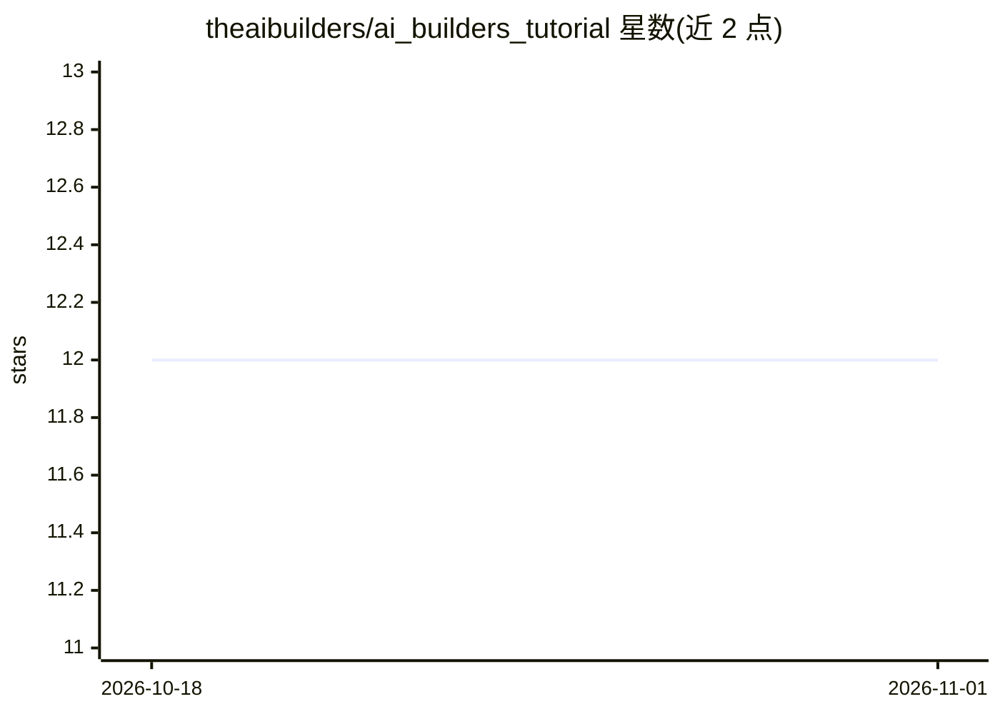

# theaibuilders/ai_builders_tutorial

⭐ 12 · Jupyter Notebook · 推送 2026-10-26 · [GitHub](https://github.com/theaibuilders/ai_builders_tutorial) · [官网](https://tutorial.theaibuilders.dev) · 组织维护

**面向 AI 应用开发的教程平台：教程站点与认证后端**

AI Builders Tutorial 是一个教程系列平台仓库：包含 Astro+Preact 前端（教程、UI 组件）与 FastAPI 后端（Circle Headless API 邮箱密码登录、Google OAuth、JWT 会话），通过 make setup/dev 三条命令本地运行。教程内容覆盖 vibe coding、自动化、模型 API、网关、框架、可观测性、微调、向量检索、浏览器代理、语音与图像视频等类别，附可运行代码与提示词模板。面向学习构建 AI 应用的开发者。

## 筛选速览

| 维度 | 判定 | 备注 |
|---|---|---|
| AI 角色 | `ai-knowledge` | 知识聚合/清单类 |
| 许可风险 | `none` | — |
| 部署形态 | `library` | 以包/库形式分发 |
| 模型依赖 | — | README 未给出锁定关系 |
| 硬件要求 | — | 无带数字的原话,不猜 |
| 安装摩擦 | `low` | 无编译、无系统依赖或容器化 |
| 成熟度 | — | 结构信号不足 |

## 能力要点

- 教程覆盖 13 个类别（vibe coding/网关/微调/浏览器代理/语音等）
- 前端 Astro+Preact、后端 FastAPI，make 三命令启动
- Circle 认证系统：邮箱密码、Google OAuth、JWT 会话

## 适用场景

- 系统学习用现代工具构建 AI 应用
- 查找可直接复用的代码示例与提示词模板
- 搭建带社区成员认证的教程站点

## 场景标签

`教程课程` · 领域:学习与行业

## 证据(README 行号)

> L3: Welcome to AI Builders Tutorial! This is a comprehensive, hands-on tutorial series for vibe coding as well as buildi
> L61: ## Tutorial Categories

## 星数曲线

2026-10-18 12 → 2026-11-01 12（+0）

---
*卡片 v1 · prompt 1.4 · 生成 2026-10-31 · 置信度 mid · 依据 README sha `922af5407dd0` · [字段定义](../../DATASET.md)*
