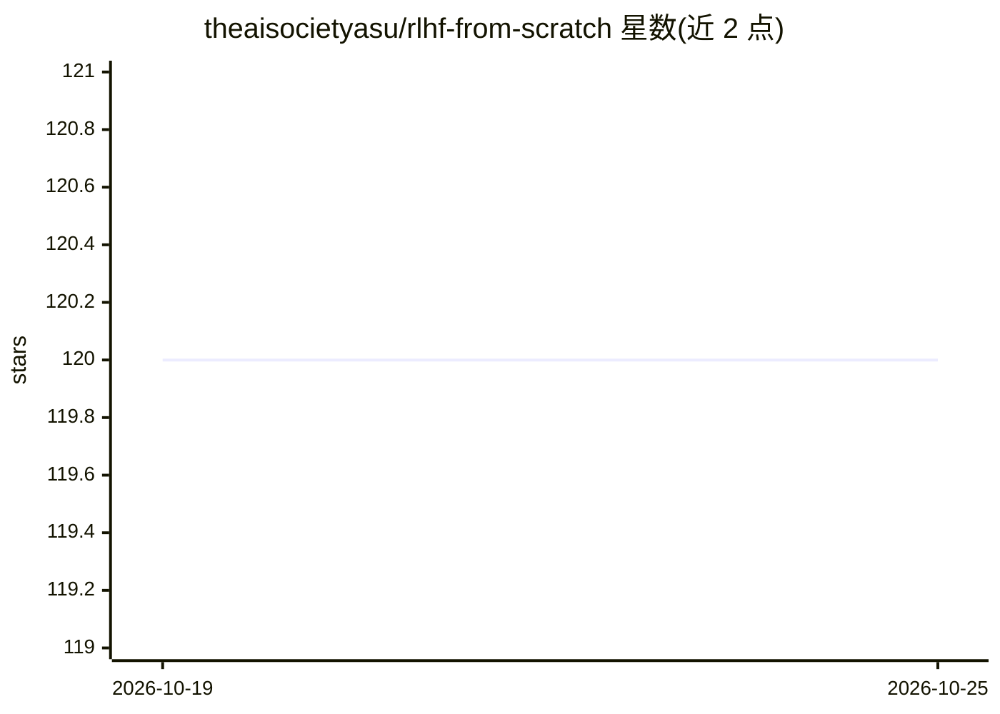

# theaisocietyasu/rlhf-from-scratch

⭐ 120 · Jupyter Notebook · Apache-2.0 · 推送 2026-10-19 · [GitHub](https://github.com/theaisocietyasu/rlhf-from-scratch) · [官网](https://colab.research.google.com/github/ashworks1706/rlhf-from-scratch/blob/main/tutorial.ipynb) · 组织维护

**RLHF 教学与最小代码示例仓库：讲解偏好数据→奖励模型→PPO**

面向学习者的 RLHF 动手教程仓库：以紧凑可读的代码实现 RLHF 主要步骤，而非生产系统。src/ppo/ 下提供简单 PPO 训练循环、rollout 与优势/回报计算等辅助例程及实验参数解析；tutorial.ipynb 串联理论、小实验与调用示例，覆盖偏好数据→奖励模型→策略优化的流水线，并演示奖励建模与 PPO 微调对比。使用方式为在 Jupyter 中打开 notebook 交互运行，或阅读 src/ppo 源码。限制：README 明确不提供生产级系统。

## 筛选速览

| 维度 | 判定 | 备注 |
|---|---|---|
| AI 角色 | `ai-knowledge` | 知识聚合/清单类 |
| 许可风险 | `permissive` | Apache-2.0 |
| 部署形态 | `None` |  |
| 模型依赖 | — | README 未给出锁定关系 |
| 硬件要求 | — | 无带数字的原话,不猜 |
| 安装摩擦 | `low` | 无编译、无系统依赖或容器化 |
| 成熟度 | — | 结构信号不足 |

## 能力要点

- PPO 训练循环（ppo_trainer.py）与奖励包装、优势/回报计算工具
- tutorial.ipynb 覆盖偏好数据→奖励模型→策略优化全流程
- 含可复现的玩具实验与可运行代码片段

## 适用场景

- 学习 RLHF 的核心流程与代码实现
- 在 Jupyter 中跑通奖励建模与 PPO 微调小实验
- 阅读最小实现理解 PPO trainer 与辅助例程

## 场景标签

`教程课程` `强化学习` · 领域:学习与行业

## 证据(README 行号)

> L5: Hands-on RLHF tutorial and minimal code examples. This repo is focused on teaching the main steps of RLHF with compa
> L16: - RLHF pipeline overview: preference data → reward model → policy optimization.

## 星数曲线

2026-10-19 120 → 2026-10-25 120（+0）

---
*卡片 v1 · prompt 1.4 · 生成 2026-10-23 · 置信度 mid · 依据 README sha `62cbf082ed1c` · [字段定义](../../DATASET.md)*
