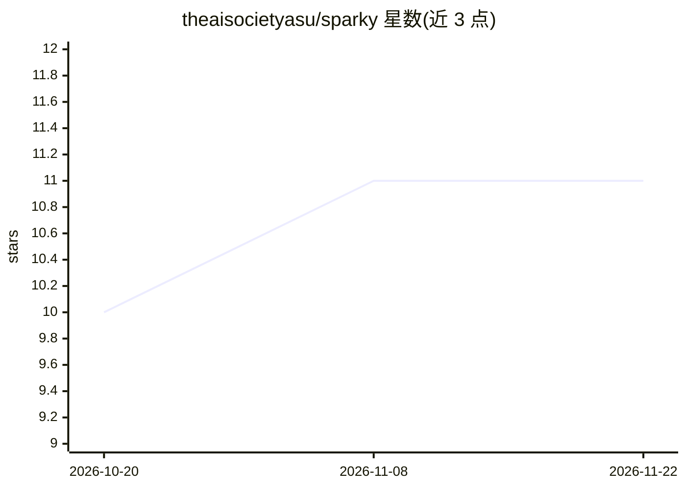

# theaisocietyasu/sparky

⭐ 11 · Rust · MIT · 推送 2026-11-18 · [GitHub](https://github.com/theaisocietyasu/sparky) · [官网](https://sparky.ais-asu.com) · 组织维护

**面向 ASU 学生的 Discord/Web 校园问答助手**

SparkyAI 是亚利桑那州立大学学生的开源非官方助手，提供 Discord 机器人、Web 聊天、CLI 控制台与评测套件。Rust 编写的 agent 引擎自带 agent 循环并自行调用工具：从 ASU 知识回答并引用原始页面、保存学生记忆、全文索引检索历史会话、读取 Canvas 日历订阅并生成截止日期提醒私信。知识检索、实时 ASU 查询、社团活动与账号关联由独立的 Platform 服务经 HTTP API 与 MCP 工具提供。运行依赖 Rust、uv、Docker、just 与一个模型服务器。

## 筛选速览

| 维度 | 判定 | 备注 |
|---|---|---|
| AI 角色 | `ai-native` | 本体是模型或模型工具 |
| 许可风险 | `permissive` | MIT |
| 部署形态 | `self-host` | docker 或自建部署 |
| 模型依赖 | — | README 未给出锁定关系 |
| 硬件要求 | — | 无带数字的原话,不猜 |
| 安装摩擦 | `low` | 无编译、无系统依赖或容器化 |
| 成熟度 | — | 结构信号不足 |

## 能力要点

- Rust agent 引擎自带循环与工具调用，含记忆与全文会话检索
- 读取 Canvas 日历订阅，后台循环生成截止日期提醒私信
- 回答引用 ASU 原始页面，支持站点排除申请
- 内置 golden case 评测套件与 baseline 提升/对比流程

## 适用场景

- 学生在 Discord 里提问校园相关并收到带引用的回答
- 按 Canvas 日历自动收到截止日期提醒
- 通过 evals 套件对 agent 行为做基线回归

## 场景标签

`聊天机器人` `模型评测` · 领域:对话与助手

## 证据(README 行号)

> L13: SparkyAI is an assistant for Arizona State University students in Discord and on the web: a Rust agent engine, a Di
> L17: The engine runs its own agent loop and calls its tools itself. Knowledge search, live ASU queries, the Sun Devil Ce

## 星数曲线

2026-10-20 10 → 2026-11-22 11（+1）

---
*卡片 v1 · prompt 1.4 · 生成 2026-11-18 · 置信度 high · 依据 README sha `7415d904ead8` · [字段定义](../../DATASET.md)*
