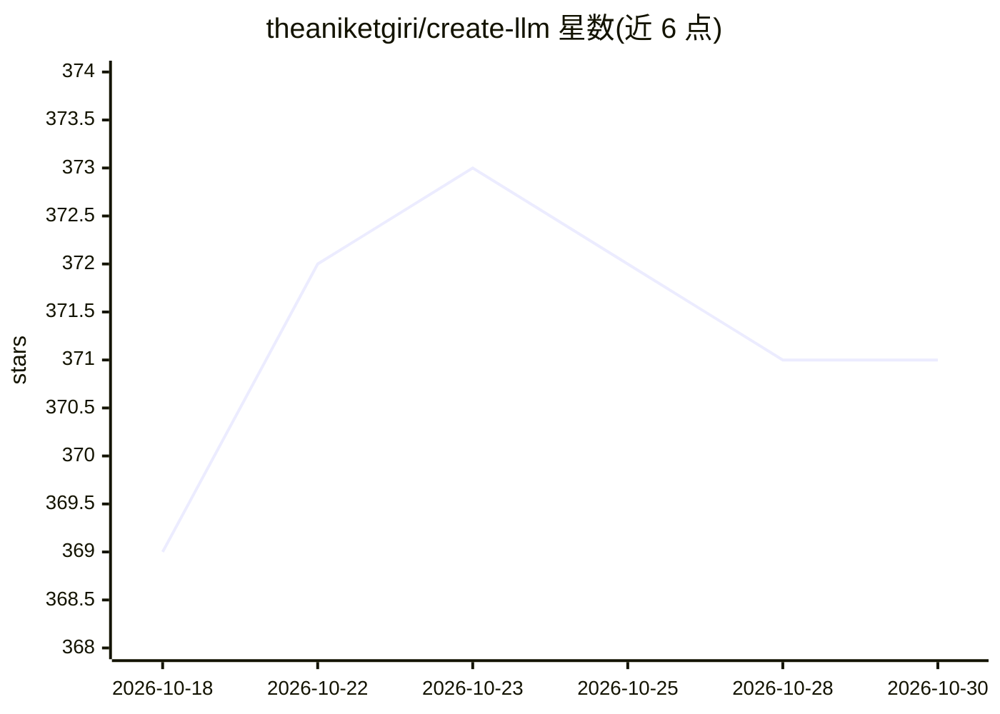

# theaniketgiri/create-llm

⭐ 371 · TypeScript · MIT · 推送 2026-09-13 · [GitHub](https://github.com/theaniketgiri/create-llm) · [官网](https://www.npmjs.com/package/create-llm) · 个人维护

**脚手架 CLI：一条命令生成并训练自定义 LLM 的 PyTorch 工程**

类似 create-next-app 的命令行脚手架工具，运行 npx create-llm 生成包含模型架构、数据预处理、分词器训练（BPE/WordPiece/Unigram）、训练循环、检查点管理、TensorBoard 监控、交互式聊天与部署脚本的 PyTorch 训练工程。提供 NANO/TINY/SMALL/BASE 四种参数量从 1M 到 1B 的模板，对应从 CPU 到多 GPU/A100 的硬件配置。面向想从零训练语言模型的开发者，支持 Docker 与 NVIDIA GPU，可选 WandB、HuggingFace 插件。

## 筛选速览

| 维度 | 判定 | 备注 |
|---|---|---|
| AI 角色 | `ai-ecosystem` | LLM/agent 周边工具 |
| 许可风险 | `permissive` | MIT |
| 部署形态 | `self-host` | docker 或自建部署 |
| 模型依赖 | — | README 未给出锁定关系 |
| 硬件要求 | `gpu-8g` | |
| 安装摩擦 | `low` | 无编译、无系统依赖或容器化 |
| 成熟度 | — | 结构信号不足 |

## 能力要点

- 一条命令生成完整 LLM 训练工程（架构/分词器/训练/评估/部署）
- 4 种参数量模板（1M~1B），标注硬件与数据量需求
- BPE/WordPiece/Unigram 分词器训练
- 部署到 Hugging Face 与 Replicate 的脚本

## 适用场景

- 快速搭建从零训练自定义 LLM 的工程骨架
- 在 CPU 上用小模板学习 LLM 训练全流程
- 为领域数据训练专用小模型并部署到 Hugging Face

## 场景标签

`代码生成` `模型训练` · 领域:编码与开发

## 证据(README 行号)

> L12: **CLI tool for scaffolding LLM Creation and training **
> L42: **create-llm provides all of this in one command.**
> L55: - PyTorch training infrastructure

## 星数曲线

2026-10-18 369 → 2026-10-30 371（+2）

---
*卡片 v1 · prompt 1.4 · 生成 2026-10-21 · 置信度 mid · 依据 README sha `a8e898a9a2c8` · [字段定义](../../DATASET.md)*
