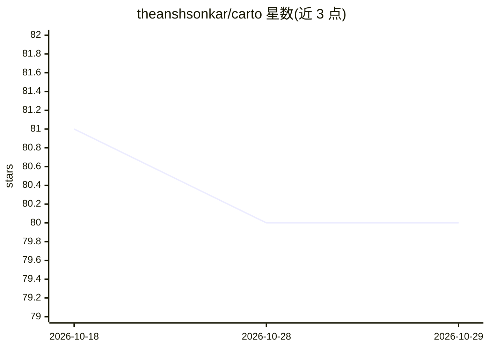

# theanshsonkar/carto

⭐ 80 · JavaScript · MIT · 推送 2026-08-31 · [GitHub](https://github.com/theanshsonkar/carto) · [官网](https://trycarto.theanshsonkar.workers.dev/) · 个人维护

**将代码库打包为便携 AI 容器，供 AI 编码工具共享上下文与风险拦截**

面向使用和开发 AI 编码工具的开发者：`carto init` 用 tree-sitter 解析仓库（支持 17 种语言的导入图、路由、模型、领域、爆炸半径、预测风险），存入本地 SQLite 文件，并通过 MCP 协议自动接入 Cursor、Claude Code、Copilot、Kiro、Windsurf 等工具。核心机制：diff 落盘前分级风险并拦截高风险编辑、跨会话记忆（结构性/情节/时序/语义/程序五类）、可导出开放 ANCI 格式单文件供其他工具免运行时读取（带 commit 戳与 sha256 摘要校验）。无云端、无遥测。

## 筛选速览

| 维度 | 判定 | 备注 |
|---|---|---|
| AI 角色 | `ai-ecosystem` | LLM/agent 周边工具 |
| 许可风险 | `permissive` | MIT |
| 部署形态 | `library` | 以包/库形式分发 |
| 模型依赖 | — | README 未给出锁定关系 |
| 硬件要求 | — | 无带数字的原话,不猜 |
| 安装摩擦 | `low` | 无编译、无系统依赖或容器化 |
| 成熟度 | — | 结构信号不足 |

## 能力要点

- 导入图 + 爆炸半径 + 0-1 预测风险评分，存于单个本地 SQLite 文件
- MCP 自动接入多种 AI 编码工具，diff 落盘前风险分级并拦截 HIGH 风险编辑
- ANCI 开放格式导出：带 commit 戳与 sha256 摘要，无需 Carto 运行时即可读取
- 五类记忆（结构/情节/时序/语义/程序）跨会话累积可查询

## 适用场景

- 让我用的 Cursor/Claude Code 等助手直接知道代码库架构与历史决策
- 改动前查询影响范围，拦截高风险 diff
- 团队共享一份可校验的代码库结构容器，避免各工具重复索引

## 场景标签

`Agent 记忆` `代码审查` · 领域:Agent 开发

## 证据(README 行号)

> L43: |Install once and Carto auto-wires into every AI tool on your machine. Your assistant instantly knows your architec
> L59: `carto init` auto-detects the AI tools on your machine and writes each one's MCP config for you. If you'd rather wi
> L115: 1. **`carto init` builds the container.** It parses your repo (imports, routes, models, domains, blast radius), wr

## 星数曲线

2026-10-18 81 → 2026-10-29 80（-1）

---
*卡片 v1 · prompt 1.4 · 生成 2026-10-24 · 置信度 high · 依据 README sha `884998aaadbb` · [字段定义](../../DATASET.md)*
