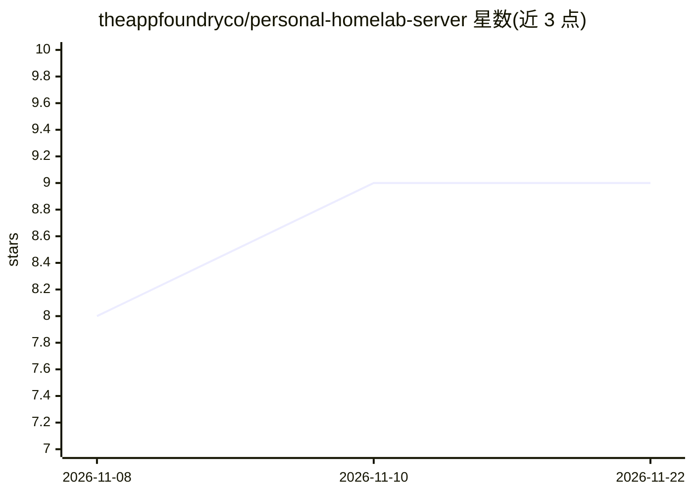

# theappfoundryco/personal-homelab-server

⭐ 9 · Python · MIT · 推送 2026-11-21 · [GitHub](https://github.com/theappfoundryco/personal-homelab-server) · [官网](https://theappfoundry.co/homelab) · 组织维护

**自托管个人助理套件：仪表盘+Telegram机器人+本地AI可选应用**

在自有机器上以 Docker 运行的私人助理：提供手机可用的仪表盘（首页简报、日记、健身、健康、笔记规划、新闻天气、航班邮件）与理解自然语言的 Telegram 机器人，附 `homelab` 命令行管理。模块化架构，每个功能是独立模块；可选安装 Ollama、Whisper、Open WebUI、Prometheus/Grafana、n8n 等应用。数据存于 `~/.homelab`，镜像版本钉死，更新前自动快照可回滚，支持一键备份恢复。要求 macOS/Linux、约 5GB 磁盘、git 与 Python 3。

## 筛选速览

| 维度 | 判定 | 备注 |
|---|---|---|
| AI 角色 | `ai-enhanced` | 去掉 AI 部分产品仍成立 |
| 许可风险 | `none` | MIT |
| 部署形态 | `None` |  |
| 模型依赖 | local-ok | 支持本地模型 |
| 硬件要求 | — | 无带数字的原话,不猜 |
| 安装摩擦 | `low` | 无编译、无系统依赖或容器化 |
| 成熟度 | — | 结构信号不足 |

## 能力要点

- 仪表盘+Telegram 机器人+命令行三合一，全部 Docker 化运行
- 可选本地 AI：Ollama 驱动聊天/日记摘要/新闻摘要，Whisper 转写语音
- 安装向导检测硬件并建议合适的本地 AI 模型
- 更新前快照、失败自动回滚，`homelab backup/restore` 一键备份恢复

## 适用场景

- 在家里自己的机器上自托管日记、健康、日程等个人数据工具
- 通过 Telegram 用自然语言设置提醒、查询自己数据
- 在局域网内运行本地模型聊天与语音转写，不依赖云服务
- 集中监控家用服务器上多个 Docker 应用的状态与日志

## 场景标签

`AI 助手` `语音识别` · 领域:对话与助手

## 证据(README 行号)

> L5: **Your day, your data, your machine.** A private assistant that runs at home: a dashboard, a Telegram bot and option
> L62: |Local AI engine (Ollama)|Runs AI models on this machine for chat, journal summaries and news.|
> L32: |**Journal**|Write your day. Optionally get a private nightly summary, a mood score, a weekly recap and deeper insi

## 星数曲线

2026-11-08 8 → 2026-11-22 9（+1）

---
*卡片 v1 · prompt 1.4 · 生成 2026-11-20 · 置信度 high · 依据 README sha `579ed36e3b9c` · [字段定义](../../DATASET.md)*
