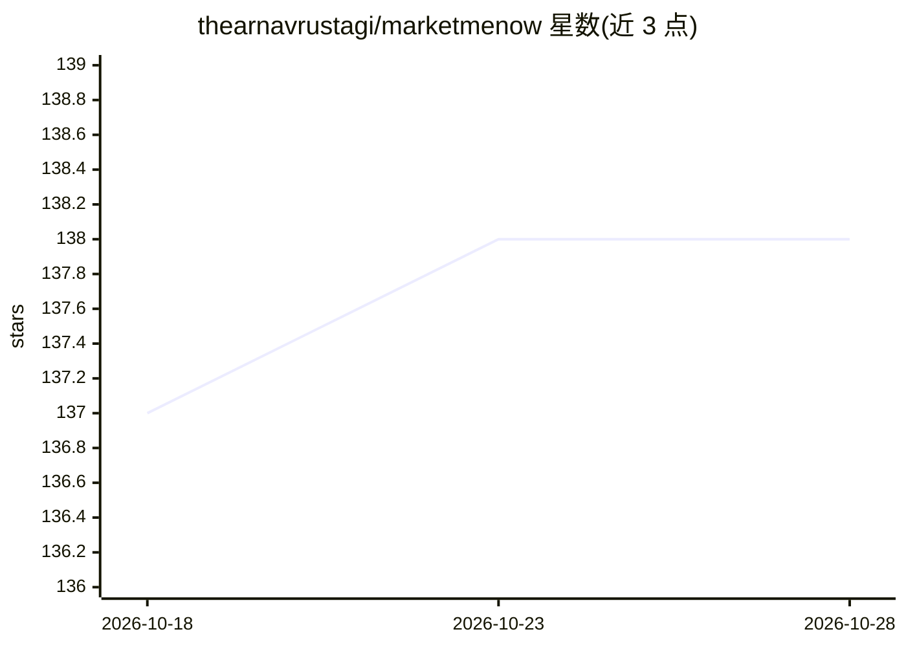

# thearnavrustagi/marketmenow

⭐ 138 · Python · MIT · 推送 2026-04-13 · [GitHub](https://github.com/thearnavrustagi/marketmenow) · 个人维护

**面向初创团队的自动化营销 Agent：一条命令生成并发布 7 平台内容**

开源的 Python 框架，用 LLM（Gemini/Vertex）生成营销内容并自动发布到 Instagram、X、Reddit、YouTube、TikTok、Email、LinkedIn 7 个平台。核心机制包括：基于表现数据的学习示例选择（epsilon-greedy in-context learning，目前限 Twitter）、Figma MCP+YAML 品牌模板、内容胶囊跨平台复用、端口-适配器架构可零改动新增平台，以及发布前剥离 AI 特征格式的 Sanitise 步骤。提供 Web 仪表盘与 CLI，按项目目录组织品牌与提示词。自述状态为 Alpha，LinkedIn 发布为 WIP。

## 筛选速览

| 维度 | 判定 | 备注 |
|---|---|---|
| AI 角色 | `ai-native` | 本体是模型或模型工具 |
| 许可风险 | `permissive` | MIT |
| 部署形态 | `None` |  |
| 模型依赖 | — | README 未给出锁定关系 |
| 硬件要求 | — | 无带数字的原话,不猜 |
| 安装摩擦 | `low` | 无编译、无系统依赖或容器化 |
| 成熟度 | `idea` | |

## 能力要点

- 单命令生成并发布 7 个平台的图文/视频/邮件内容
- in-context learning 从高表现帖子学习风格（epsilon-greedy 采样）
- 内容胶囊跨平台复用（LLM 驱动的格式转换）
- 端口-适配器架构，新增平台零核心改动

## 适用场景

- 作为独立创始人自动生成并发布社媒内容，减少日常运营时间
- 批量生成个性化外联邮件（CSV 输入）
- 将一条内容自动改写为其他平台的格式并分发

## 场景标签

`浏览器自动化` `AI 写作` `图像生成` · 领域:效率与自动化

## 证据(README 行号)

> L9:  Open-source framework that generates and publishes marketing content across 7 platforms from a single command.
> L97: |AI (all)|AI Studio: `GEMINI_API_KEY` (or `GOOGLE_API_KEY`) **or** Vertex: `GOOGLE_APPLICATION_CREDENTIALS`, `VERTE

## 星数曲线

2026-10-18 137 → 2026-10-28 138（+1）

---
*卡片 v1 · prompt 1.4 · 生成 2026-10-22 · 置信度 high · 依据 README sha `d58d9d1b96c3` · [字段定义](../../DATASET.md)*
