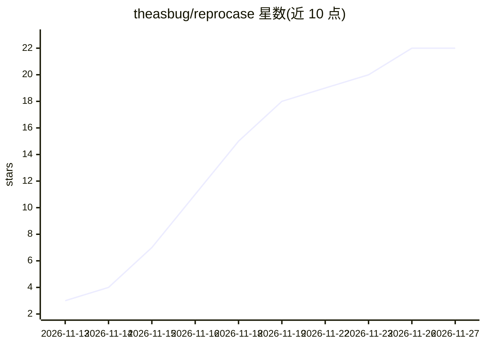

# theasbug/reprocase

⭐ 22 · TypeScript · Apache-2.0 · 推送 2026-11-25 · [GitHub](https://github.com/theasbug/reprocase) · [官网](https://theasbug.github.io/reprocase/) · 个人维护

**IDOR/BOLA 授权漏洞的可复现证明工具，给赏金猎人用**

面向漏洞赏金猎人、triager 与 AppSec 团队的访问控制漏洞验证工具：将 IDOR/越权/CORS 发现转为可执行的 JSON case，每次运行用新建测试账号与新鲜资源，通过身份/租户探测、对象所有权观测与唯一标记读取三项检查，输出 reproduced/not_reproduced/inconclusive 三态判定。提供 Windows/macOS/Linux 桌面应用（Electron）、Docker、Burp 扩展与 CLI/MCP。AI 助手为可选附加（自带模型、默认关闭），判定始终来自确定性检查；可导入 Arjun/ffuf 输出生成线索排序。

## 筛选速览

| 维度 | 判定 | 备注 |
|---|---|---|
| AI 角色 | `ai-enhanced` | 去掉 AI 部分产品仍成立 |
| 许可风险 | `permissive` | Apache-2.0 |
| 部署形态 | `desktop` | 安装包/桌面程序 |
| 模型依赖 | — | README 未给出锁定关系 |
| 硬件要求 | — | 无带数字的原话,不猜 |
| 安装摩擦 | `low` | 无编译、无系统依赖或容器化 |
| 成熟度 | — | 结构信号不足 |

## 能力要点

- 三态判定引擎：身份探测、新鲜对象所有权、本轮唯一标记跨界验证
- Quick proof 通过观察目标自动学习身份端点与字段，无需手写 JSON Pointer
- 桌面应用/Docker/Burp 扩展/CLI/MCP 多形态交付，内置本地演示
- case 可存为模板复用到其他目标，共享包不含凭据

## 适用场景

- 提交带自证 case 的漏洞报告，避免'无法复现'被拒
- triager 用自己的测试账号在数秒内复验报告
- 修复后将 case 作为回归检查重跑
- 从 Arjun/ffuf 输出中筛选值得证明的 IDOR 线索

## 场景标签

`网络安全` · 领域:学习与行业

## 证据(README 行号)

> L28: ReproCase turns the finding into a **case**: a small JSON file that anyone can run with **their own accounts and ne
> L36: Every run ends in exactly one verdict: **`reproduced`**, **`not_reproduced`**, or **`inconclusive`**. An expired se
> L149: **AI assistant (bring your own model, off by default).** Use it to investigate and draft cases. The verdict always

## 星数曲线

2026-11-13 3 → 2026-11-27 22（+19）

---
*卡片 v1 · prompt 1.4 · 生成 2026-11-18 · 置信度 mid · 依据 README sha `e635a2eaab33` · [字段定义](../../DATASET.md)*
