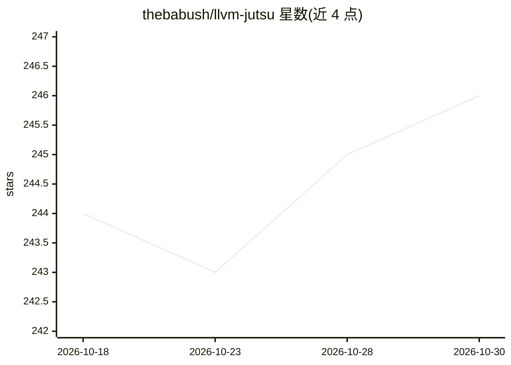

# thebabush/llvm-jutsu

⭐ 246 · C++ · MIT · 推送 2025-12-22 · [GitHub](https://github.com/thebabush/llvm-jutsu) · 个人维护

**LLVM 混淆 pass：把整数常量编码成手势图阻碍 LLM 逆向**

一个 LLVM 编译器混淆 pass，面向软件保护场景：编译期找出与 i32 常量比较的指令，把常量按每字节一只手（手指伸/弯表示位）渲染成 PNG 嵌入二进制，并将比较替换为运行时的图像比较函数，使常量不在二进制中以数值形式出现。附带旋转、色相偏移、跨手依赖等增加视觉模型解析难度的变换。仅支持 i32 eq/ne 比较；运行时图像渲染有性能开销，每个常量嵌入约 30KB PNG。需 LLVM 15+，通过 make 构建为 LLVM pass。README 以戏谑口吻写成，自述限制明确。

## 筛选速览

| 维度 | 判定 | 备注 |
|---|---|---|
| AI 角色 | `ai-ecosystem` | LLM/agent 周边工具 |
| 许可风险 | `permissive` | MIT |
| 部署形态 | `None` |  |
| 模型依赖 | — | README 未给出锁定关系 |
| 硬件要求 | — | 无带数字的原话,不猜 |
| 安装摩擦 | `low` | 无编译、无系统依赖或容器化 |
| 成熟度 | `idea` | |

## 能力要点

- 编译期把 i32 常量渲染为手势 PNG 并嵌入二进制，常量数值不再可 grep
- 运行时以相同手势几何渲染输入值并做图像比较
- 旋转/色相偏移/描边随机化/手指抖动等哈希派生变换，且跨手依赖整体 32 位值
- 仅处理 i32 eq/ne 比较，每常量约增 30KB 体积

## 适用场景

- 给 crackme/带授权检查的软件增加对抗 LLM 逆向的混淆
- 研究 LLVM pass 层面的非常规常量编码方式
- 考察视觉混淆对多模态模型解析的影响

## 场景标签

`网络安全` · 领域:学习与行业

## 证据(README 行号)

> L9: It's 2025. You've spent weeks crafting the perfect license check. You've used every trick in the book: opaque predic
> L84: ## Anti-LLM Features
> L127: **llvm-jutsu** is a return to tradition. The reverser must *look* at the hands. *Read* the fingers. *Feel* the bit

## 星数曲线

2026-10-18 244 → 2026-10-30 246（+2）

---
*卡片 v1 · prompt 1.4 · 生成 2026-10-22 · 置信度 mid · 依据 README sha `a6359c23f3a3` · [字段定义](../../DATASET.md)*
