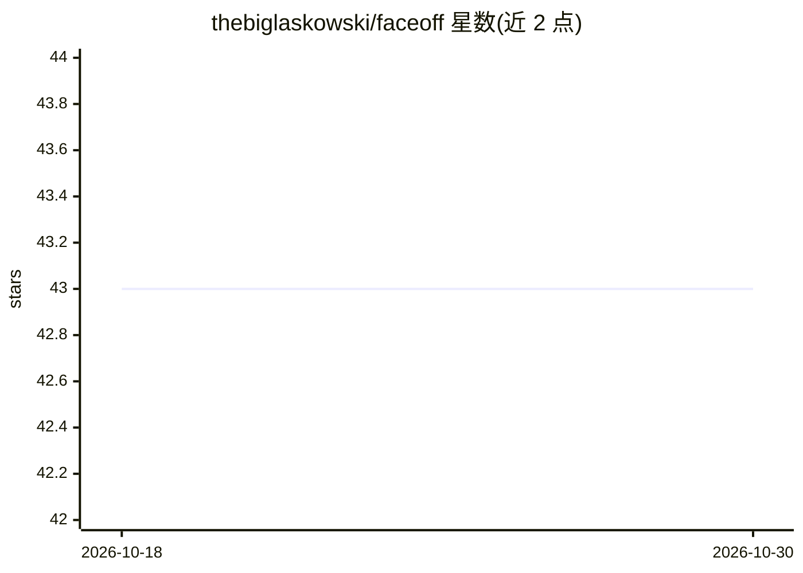

# thebiglaskowski/faceoff

⭐ 43 · Python · MIT · 推送 2026-10-14 · [GitHub](https://github.com/thebiglaskowski/faceoff) · [官网](https://thebiglaskowski.com/) · 个人维护

**本地 GPU 加速的 AI 换脸工具：图片/GIF/视频**

完全本地运行的换脸应用：以源人脸图替换目标图片、GIF 或视频（音频保留）中的人脸，基于 InsightFace/ONNX Runtime 推理，支持多 GPU VRAM 感知调度、流式分块处理、可选 GFPGAN/CodeFormer 面部修复与 Real-ESRGAN/HAT/SwinIR 超分辨率增强。提供 Gradio Web UI（含多脸映射、模型下载、终端日志页）。要求 Python 3.12、NVIDIA GPU 与 FFmpeg，经 uv 从源码安装，无遥测、无云端依赖。

## 筛选速览

| 维度 | 判定 | 备注 |
|---|---|---|
| AI 角色 | `ai-native` | 本体是模型或模型工具 |
| 许可风险 | `permissive` | MIT |
| 部署形态 | `desktop` | 安装包/桌面程序 |
| 模型依赖 | — | README 未给出锁定关系 |
| 硬件要求 | `gpu-8g` | |
| 安装摩擦 | `high` | 编译与系统依赖俱全 |
| 成熟度 | — | 结构信号不足 |

## 能力要点

- 图片/GIF/视频换脸，音频保留，多脸可在 UI 中逐脸指定源脸
- 多 GPU 调度、流式分块管线、NVDEC 解码与可选 TensorRT
- 可选 GFPGAN/CodeFormer 修复与 Real-ESRGAN/HAT/SwinIR 超分增强
- 完全本地运行，无云端/账号/遥测

## 适用场景

- 把照片中的人脸替换为指定源脸并导出
- 对 GIF 或视频做换脸处理且保留音轨
- 换脸后叠加超分辨率或面部修复提升清晰度

## 场景标签

`图像视频处理` · 领域:感知与多模态

## 证据(README 行号)

> L3: **Local, GPU-accelerated face swapping — Image · GIF · Video**
> L41:  🎭 Universal face swap Images (PNG/JPG/WEBP/BMP), animated GIFs, and video (MP4/WEBP/AVI/MOV) — audio preserved
> L53:  🔒 Fully local No cloud, no accounts, no telemetry — media never leaves your machine

## 星数曲线

2026-10-18 43 → 2026-10-30 43（+0）

---
*卡片 v1 · prompt 1.4 · 生成 2026-10-25 · 置信度 high · 依据 README sha `a61e257f39d2` · [字段定义](../../DATASET.md)*
