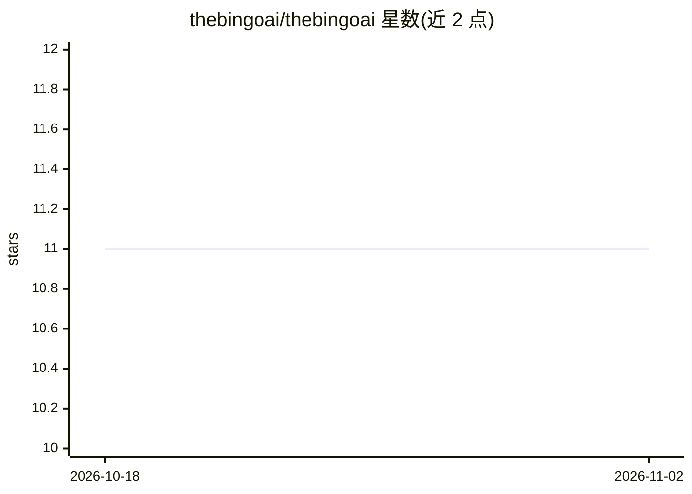

# thebingoai/thebingoai

⭐ 11 · Python · NOASSERTION · 推送 2026-09-07 · [GitHub](https://github.com/thebingoai/thebingoai) · [官网](https://thebingo.ai) · 组织维护

**开源 BI 平台：AI 仪表盘、RAG 实时对话与多数据库接入**

基于 FastAPI + Nuxt 4 + LangGraph 的自助式 BI 平台：提供拖拽式 AI 仪表盘（GridStock 组件）、WebSocket 实时聊天并带 RAG、多 LLM 供应商支持（OpenAI/Anthropic/Ollama）、PostgreSQL 与 MySQL 连接器、含编排/数据/仪表盘/RAG/监控五类 agent 的代理系统、持久化记忆与文档索引向量检索（Qdrant）。通过 Docker Compose 一键启动全部服务；必填 OPENAI_API_KEY。采用 Bingo Sustainable Use License（fair-code，禁止对外提供托管服务），商业托管需联系官方。

## 筛选速览

| 维度 | 判定 | 备注 |
|---|---|---|
| AI 角色 | `ai-enhanced` | 去掉 AI 部分产品仍成立 |
| 许可风险 | `none` | NOASSERTION |
| 部署形态 | `self-host` | docker 或自建部署 |
| 模型依赖 | local-ok | 支持本地模型 |
| 硬件要求 | — | 无带数字的原话,不猜 |
| 安装摩擦 | `low` | 无编译、无系统依赖或容器化 |
| 成熟度 | — | 结构信号不足 |

## 能力要点

- 拖拽式 AI 仪表盘与定时刷新
- WebSocket 实时聊天 + RAG 与持久记忆
- 多 LLM 供应商（OpenAI/Anthropic/Ollama）可切换
- 编排、数据、仪表盘、RAG、监控五类 agent 与 Celery 后台任务

## 适用场景

- 自助搭建带 AI 对话的数据看板
- 对已索引文档用自然语言提问
- 在同一平台连接 PostgreSQL/MySQL 做查询分析

## 场景标签

`RAG` `数据分析` `聊天机器人` · 领域:效率与自动化

## 证据(README 行号)

> L10: - **AI-powered dashboards** with drag-and-drop widgets (GridStack)
> L12: - **Multi-provider LLM support** (OpenAI, Anthropic, Ollama)

## 星数曲线

2026-10-18 11 → 2026-11-02 11（+0）

---
*卡片 v1 · prompt 1.4 · 生成 2026-11-01 · 置信度 high · 依据 README sha `8d6a00c28e6c` · [字段定义](../../DATASET.md)*
