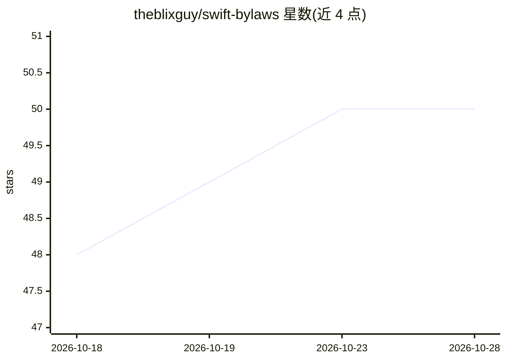

# theblixguy/swift-bylaws

⭐ 50 · Swift · MIT · 推送 2026-10-27 · [GitHub](https://github.com/theblixguy/swift-bylaws) · [官网](https://theblixguy.github.io/swift-bylaws/documentation/bylaws/) · 个人维护

**面向开发者与编码代理的 Swift 架构规则检查器**

Swift 架构 lint 工具，供开发者和 AI 编码代理使用：用 Swift API 编写项目规则（命名、层间依赖、文件夹布局、Package.swift 与 import 一致性等），通过 CLI（bylaws lint）或 Swift Testing 运行，违规时报出文件与行号，支持 autocorrect、baseline、CI 增量（--changed-path）与 SARIF 输出。规则可读编译索引获得解析后的引用。需 Swift 6.2+，CLI 支持 macOS 14+/Linux，规则文件为 Bylaws.swift。

## 筛选速览

| 维度 | 判定 | 备注 |
|---|---|---|
| AI 角色 | `ai-enhanced` | 去掉 AI 部分产品仍成立 |
| 许可风险 | `permissive` | MIT |
| 部署形态 | `None` |  |
| 模型依赖 | — | README 未给出锁定关系 |
| 硬件要求 | — | 无带数字的原话,不猜 |
| 安装摩擦 | `low` | 无编译、无系统依赖或容器化 |
| 成熟度 | — | 结构信号不足 |

## 能力要点

- 用 Swift API 编写架构规则，经 CLI 或 Swift Testing 运行
- 检查层间依赖、文件夹布局、Package.swift 与 import 一致性、依赖环
- 支持 autocorrect、baseline、CI 增量与 SARIF 输出
- 违规报出文件与行号，供开发者与编码代理修复

## 适用场景

- 为团队项目把编译器无法强制的架构约定固化为可执行规则
- AI 编码代理提交改动后自动核查是否破坏项目规则
- 在 CI 中增量运行规则并输出 SARIF 报告

## 场景标签

 · 领域:开发者工具/Swift 代码质量

## 证据(README 行号)

> L3: Bylaws is an architectural linter for Swift, built for developers and coding agents.
> L24: also break project rules and be difficult to review line by line. Skill files

## 星数曲线

2026-10-18 48 → 2026-10-28 50（+2）

---
*卡片 v1 · prompt 1.4 · 生成 2026-10-24 · 置信度 high · 依据 README sha `e328f078ebf6` · [字段定义](../../DATASET.md)*
