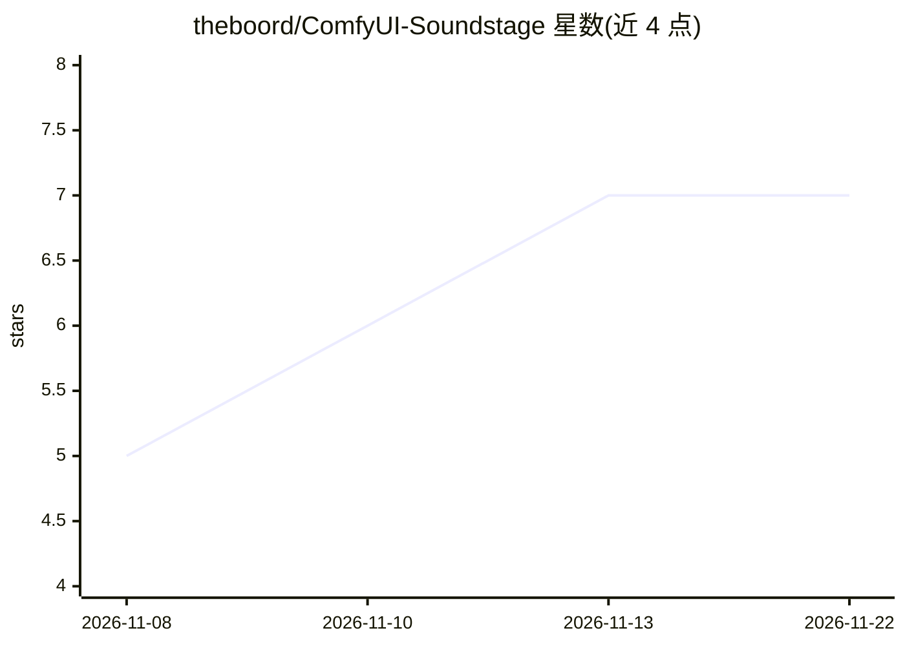

# theboord/ComfyUI-Soundstage

⭐ 7 · JavaScript · MIT · 推送 2026-11-10 · [GitHub](https://github.com/theboord/ComfyUI-Soundstage) · [官网](https://claude.ai/artifact/GwtC3yFZtGCsTsiPGbvnAq) · 组织维护

**给影视创作者的 ComfyUI 3D 片场：从剧本到成片剪辑**

ComfyUI 自定义节点与配套 App，模拟真实片场工作流：加载 Fountain/Final Draft/PDF 剧本并自动拆解为场景、演员与场地；在 3D 舞台上排戏（布景、角色、镜头、特技、物理动作），手机扫码可作取景器；开源权重模型按排位渲染分镜与带声音的视频（FLUX 3 Klein 出帧、LTX-2.5 出动效与声音），并支持角色替换、动作/表演捕捉、实时时间线剪辑与导出到专业剪辑软件。需 ComfyUI 0.39+，模型在本机 GPU 上运行。

## 筛选速览

| 维度 | 判定 | 备注 |
|---|---|---|
| AI 角色 | `ai-native` | 本体是模型或模型工具 |
| 许可风险 | `permissive` | MIT |
| 部署形态 | `library` | 以包/库形式分发 |
| 模型依赖 | — | README 未给出锁定关系 |
| 硬件要求 | — | 无带数字的原话,不猜 |
| 安装摩擦 | `low` | 无编译、无系统依赖或容器化 |
| 成熟度 | — | 结构信号不足 |

## 能力要点

- 剧本拆解与 ScriptSync：剧本行与每条 take 联动回放
- 3D 排位驱动开源模型渲染：FLUX 3 Klein + LTX-2.5 出带声音镜头
- 手机扫码即取景器，可在浏览器运行无需安装 App
- 支持 SAM 3.1 追踪的角色替换与网络摄像头动捕/口型同步

## 适用场景

- 把剧本拆解为 3D 预演并渲染带声音的样片
- 用手机当取景器在现场走位拍摄镜头运动
- 对实拍素材做单角色替换并保留原声
- 在实时时间线上剪辑生成的 take 并导出到剪辑软件

## 场景标签

`图像生成` `视频生成` · 领域:内容生成

## 证据(README 行号)

> L29: Soundstage is ComfyUI custom nodes plus an App that work like a film set: you block a scene in 3D (set, lifelike ca
> L84: - **Default, open weights:** LTX-2.5 union control (pose + face), on your own GPU.

## 星数曲线

2026-11-08 5 → 2026-11-22 7（+2）

---
*卡片 v1 · prompt 1.4 · 生成 2026-11-20 · 置信度 low · 依据 README sha `71aa646d3d87` · [字段定义](../../DATASET.md)*
