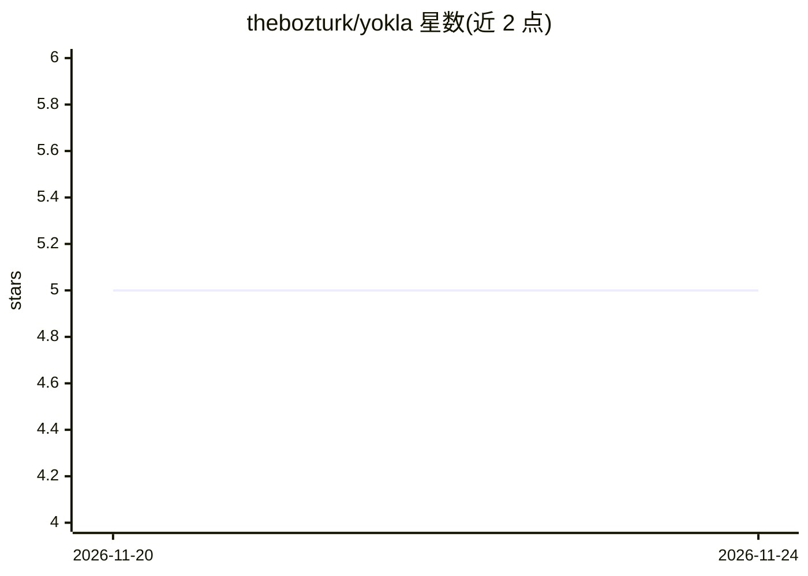

# thebozturk/yokla

⭐ 6 · TypeScript · Apache-2.0 · 推送 2026-11-23 · [GitHub](https://github.com/thebozturk/yokla) · [官网](https://www.npmjs.com/package/yokla) · 个人维护

**对话式 AI 助手的端到端测试 CLI：确定性校验回答质量与安全**

以 CLI 形式运行的测试工具：向被测助手发送用户会问的问题（HTTP/WebSocket，无需 SDK 或改代码），将每个回答与用户自己的目录、价格、库存、政策数据做确定性比对，同时通过本地模型代理观测每轮的模型调用、token、成本、提示词与工具调用，并定位错误值的来源。覆盖注入攻击、故障注入（429/500/503、超时、截断流）、多轮对话、成本预算与 CI 门禁。判定不依赖模型，土耳其语与英语为一等支持。需要 Node.js 24+，本地运行，无遥测。

## 筛选速览

| 维度 | 判定 | 备注 |
|---|---|---|
| AI 角色 | `ai-ecosystem` | LLM/agent 周边工具 |
| 许可风险 | `permissive` | Apache-2.0 |
| 部署形态 | `library` | 以包/库形式分发 |
| 模型依赖 | — | README 未给出锁定关系 |
| 硬件要求 | — | 无带数字的原话,不猜 |
| 安装摩擦 | `low` | 无编译、无系统依赖或容器化 |
| 成熟度 | `idea` | |

## 能力要点

- 基于用户自有数据的确定性校验，判定无需模型调用、零模型成本
- 本地模型代理观测每轮调用、成本、提示词、工具调用并定位错误来源
- 故障注入与间接注入测试（429/500/503、截断流、tool result 注入）
- yokla gate 输出退出码供 CI 使用，支持 JUnit XML 与离线 HTML 报告

## 适用场景

- 上线前对客服聊天机器人做事实性校验，拦截编造价格/库存的回答
- 在 CI 中为助手设置质量门禁与成本/延迟预算
- 对助手做红队测试：提示注入、越权工具调用、故障下的行为
- 录制/回放模型调用，让测试套件零成本重复运行

## 场景标签

`模型评测` · 领域:评测与运维

## 证据(README 行号)

> L3: **End-to-end tests for conversational AI assistants:
> L17: asks your assistant the questions your customers ask, over the same API
> L199: - **The checks** are deterministic first. A model is never needed to judge

## 星数曲线

2026-11-20 5 → 2026-11-24 5（+0）

---
*卡片 v1 · prompt 1.4 · 生成 2026-11-21 · 置信度 high · 依据 README sha `5b8bcd1061fc` · [字段定义](../../DATASET.md)*
